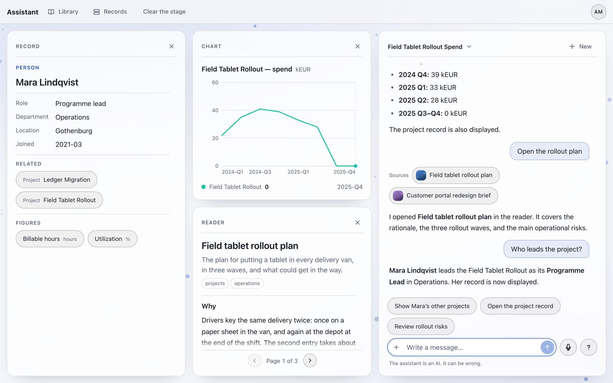

<p align="center"> &nbsp;&nbsp;&nbsp;&nbsp; <picture><source media="(prefers-color-scheme: dark)" srcset="site/public/logos/impact-ai-dark.svg"></picture></p>

# Agent on Azure

**A deployable voice and chat assistant on Microsoft Foundry. It answers from business systems and from the documents each person may read (enforced in hardened mode), and shows what it finds on a visual stage beside the conversation.**

Start from assembled application patterns: sign-in, voice, retrieval and the Azure deployment are already connected, and your team writes the customer's integrations.

People sign in, type or speak in five languages (English, Italian, Spanish, French and German), and get answers from a document library and from business records. The assistant looks records up on the person's behalf, passing on who is asking, so the business system can apply that person's permissions (the backend calls as itself); the sample records are open to everyone ([what changes and what does not](docs/worked-example.md#what-changes-and-what-does-not)). Each answer comes with the documents, pictures, charts and records it draws on, shown on the **stage**: the visual workspace beside the conversation, where the assistant and the person open the same views.

It runs in your Azure environment on Foundry Agent Service, Azure OpenAI and Azure AI Search, supported by Cosmos DB, Managed Redis, Blob Storage and App Configuration; the [component map](docs/patterns.md#microsoft-components) explains each service's role. Azure services are reached with Microsoft Entra ID and managed identities, with no keys; the application's own sign-in signs its sessions, and talks to Microsoft Entra ID, with secrets kept in Key Vault ([identities and keys](docs/security.md#identities-and-keys)). [Is it a fit?](docs/is-it-a-fit.md) covers the customer projects it suits, the work it leaves to you and what it costs to run.

Except the Impact SDK setup plugin (`plugins/impact-sdk-setup`, Apache-2.0), the code and documentation are MIT licensed, copyright Microsoft Corporation; created and maintained by Impact AI ([license](#license)). Agent on Azure is open source with no service level. Impact AI maintains it; Microsoft supports the Azure services it deploys, not this code ([who supports what](docs/is-it-a-fit.md#who-supports-what)).



[Watch a spoken question put a chart on the stage](https://impact-ai.github.io/foundry-agents/#what-it-is) on the documentation site.

## Start here

- **Evaluating**: systems integrators and decision-makers weighing a customer project start with [Is it a fit?](docs/is-it-a-fit.md): where it fits, the work it leaves to you, who supports what, and the running cost.
- **Building**: application and platform teams adapting it for a customer start with [Patterns](docs/patterns.md) and [Adapting](docs/adapting.md), then the [Worked example](docs/worked-example.md).
- **Deploying**: operations engineers putting it in an Azure subscription start with [Deployment](docs/deployment.md), then [Operations](docs/operations.md).
- **Accepting**: delivery managers signing off before handover start with [Acceptance](docs/acceptance.md) and its [record of results](docs/acceptance.md#recording-the-result).

## Optional add-ons

Agent on Azure, this open-source repository, is what you build and run your application from. Nothing else is required. Impact AI offers two separately licensed products on top ([Impact AI add-ons](docs/impact-ai.md), [contact Impact AI](https://www.impact.ai/)):

- **[Impact AI Admin Center](docs/impact-ai.md#impact-ai-admin-center)** is a separate product, not included in this repository and not needed to use it. It makes maintaining agent-based applications easier: teams change prompts, guardrail wording, tool switches, documents and supported settings through forms instead of code.
- **[Impact AI Control Plane](docs/impact-ai.md#impact-ai-control-plane)** is a separate product for testing, monitoring and improving an application through evaluations, traces and comparisons; it is not needed to use Agent on Azure. Its SDK setup plugin for [Codex](docs/patterns.md#terms) (pre-release) ships in this repository. Evaluations and comparisons are not yet available for Agent on Azure, and capture of its Foundry turns and live voice is not yet verified.

## Patterns

[Patterns](docs/patterns.md) lists everything that comes assembled. Four of them define how you adapt it:

- **Conversation-driven UI**: the assistant puts documents, pictures, charts and records on screen, and people can open the library, a document, a record or a record's figures by hand.
- **One set of tools for voice and text**: a tool is written once, and both channels call it as the same person.
- **Permission-aware retrieval**: with document access enforcement on, as it is in hardened mode from the first deploy, search and document reads return only what the person may read, checked against their verified identity.
- **Product separated from platform**: business tools and views are product code, the persona is published data, and the supporting packages are reused as they are.

[Adapting](docs/adapting.md) says whether each change is data, settings, code or a deploy-time decision. The [worked example](docs/worked-example.md) connects a business system end to end, and [acceptance](docs/acceptance.md) describes how to accept the adapted application.

## Quick start

You need an Azure subscription where you are Owner (or Contributor and User Access Administrator), the [Azure Developer CLI](https://learn.microsoft.com/azure/developer/azure-developer-cli/install-azd) and the [Azure CLI](https://learn.microsoft.com/cli/azure/install-azure-cli). The bash hooks also call `openssl` and `ssh-keygen`; most macOS and Linux installs have both, and the [dev container](.devcontainer/devcontainer.json) has everything. Images build in Azure, so the deployment needs no Docker or Bun ([prerequisites](docs/deployment.md#prerequisites)).

```sh
azd auth login
az login
azd env new my-agent --location swedencentral --subscription <subscription id>   # a region with quota for the models
azd env set AZURE_SEARCH_LOCATION northeurope    # only if the region has no AI Search capacity
azd up
```

A run takes about 30 minutes when the region has capacity. Some regions refuse new Azure AI Search services; if provisioning fails, [troubleshooting](docs/deployment.md#troubleshooting) explains the error and the fix. When azd finishes, open the frontend's `Endpoint:` (`FRONTEND_URL` in `azd env get-values`) and sign in with any name. This is **demo** mode: public endpoints and a name-only sign-in where every sign-in is a new person, never for real data.

Three things to try:

1. **Library**: ask the assistant to show the library, and the sample documents open on the stage. The Library button in the top bar opens the same view. The assistant can open views but cannot change settings.
2. **A question answered from a document**: ask what the depot checklist says about a parcel with no label. The reply names the document it drew on, and a chip under it opens that document in the reader, so the person can check the answer against it.
3. **Voice**: press **Open the channel** in the voice pane and ask the same. The same knowledge reaches the same stage, spoken.

Then load more documents with `./scripts/ingest.sh ~/my-docs` ([load a library](docs/documents.md#load-a-library)). On a demo deployment load only sample or public documents: anyone can sign in with a name, and document readers are not enforced. Customer documents belong on a hardened deployment. Check the deployment with the smoke test, `./scripts/smoke.sh`, which needs `azd` and `curl` ([check a deployment](docs/operations.md#check-a-deployment)). The fuller deployment checker and the persona CLI run on [Bun](https://bun.sh) ([deployment checker](docs/deployment.md#deployment-checker), [changing the persona](docs/operations.md#changing-the-persona)).

**Hardened** mode is the same template with `azd env set HARDENED true` before `azd up`: a virtual network with private endpoints, Front Door Premium with a WAF, sign-in through Entra only with a role required, locks, purge protection and zone redundancy ([demo and hardened](docs/deployment.md#demo-and-hardened)). The deployment hooks create the Entra app registration under your account and assign you its roles; where you may not register applications, they print the steps for someone who may. [A fresh hardened run](docs/deployment.md#a-fresh-hardened-run) lists everything it sets, in order, and a clean run takes about an hour. When it finishes, open `FRONTEND_URL` from `azd env get-values`, not the `Endpoint:` azd prints, and expect Front Door to answer 404 for up to about 20 minutes while it propagates.

## Documentation

The same pages, grouped as on the [documentation site](https://impact-ai.github.io/foundry-agents/).

| Page | What is in it |
| --- | --- |
| **Overview** | |
| [Is it a fit?](docs/is-it-a-fit.md) | Five questions before quoting a project: what your team would build, whether the use case fits, whether your team can deliver it, whether the customer can run it in production, and what it costs to run |
| [Cost](docs/cost.md) | The fixed monthly price of each service in demo and hardened mode, the optional extras, a usage formula and a worked example |
| **Build** | |
| [Patterns](docs/patterns.md) | The assembled patterns, what you adapt and where the code is, and four of them in depth |
| [Adapting](docs/adapting.md) | What a team changes and what each change costs; flexible and Azure-specific choices; fallbacks |
| [Worked example](docs/worked-example.md) | A business system connected end to end, the files changed and its verification |
| [Extending](docs/extending.md) | Your own product, tools, stage controls, skills, settings, languages, a second agent host, document types |
| [Documents](docs/documents.md) | The library format, `access.json`, loading and removing libraries, the reader, the two retrieval engines, the sources under a reply |
| [Development](docs/development.md) | Running locally with no Azure, or against a deployment's services |
| [Testing](docs/testing.md) | Test layers, commands, CI |
| **Deploy and run** | |
| [Deployment](docs/deployment.md) | Prerequisites, demo and hardened, the WAF, Entra sign-in, regions and quota, cost, developer access, CI/CD, clean-up, troubleshooting |
| [Operations](docs/operations.md) | Smoke test, monitoring and log queries, tuning live, metering and premium, the persona, the agent on Foundry, secret rotation, scaling, backups |
| [Security](docs/security.md) | Sign-in modes, gates, keyless access, network, WAF, model safety, known gaps |
| [Privacy](docs/privacy.md) | What is stored where and for how long, export and erasure, AI disclosure |
| **Accept** | |
| [Acceptance](docs/acceptance.md) | Reusable acceptance scenarios, with stand-ins and live |
| [Evaluation](docs/evaluation.md) | The included checks and Microsoft's tracing and evaluation tooling |
| **Reference** | |
| [Architecture](docs/architecture.md) | The topology of each mode, a typed turn, a voice turn, ingestion, identities and roles, data stores, what is Foundry's and what is the deployment's own |
| [Configuration](docs/configuration.md) | Every deployment parameter, environment variable and settings document, with defaults |
| [Decisions](docs/decisions.md) | The design decisions, with the reasons and the Microsoft Learn pages behind them |
| [Repository](docs/repository.md) | The layout, each package, dependency direction, the boundaries the build enforces |
| [Limitations](docs/limitations.md) | Every known limitation, whose it is, the evidence, and what Agent on Azure does about it |
| **Optional** | |
| [Impact AI add-ons](docs/impact-ai.md) | Impact AI Admin Center and Impact AI Control Plane, where your data goes, and license boundaries |

Each package and app has its own README: [`apps/backend`](apps/backend/README.md), [`apps/frontend`](apps/frontend/README.md), and the packages under [`platform/`](docs/repository.md#the-packages).

## License

Except the Impact SDK setup plugin (`plugins/impact-sdk-setup`, Apache-2.0, [its license](plugins/impact-sdk-setup/LICENSE)), the code and documentation are [MIT licensed](LICENSE), copyright Microsoft Corporation. Impact AI is the creator and maintainer. Impact AI Admin Center, Impact AI Control Plane and Impact AI's commercial services are governed by their own terms; this repository's license grants no rights to them. Third-party dependencies retain their own licenses.

The logos under [`site/public/logos/`](site/public/logos/) are not part of that grant. Each is its owner's trademark, and the license gives no right to use it.

### Trademarks

This project may contain trademarks or logos for projects, products, or services. Authorized use of Microsoft trademarks or logos is subject to and must follow [Microsoft's Trademark & Brand Guidelines](https://www.microsoft.com/en-us/legal/intellectualproperty/trademarks/usage/general). Use of Microsoft trademarks or logos in modified versions of this project must not cause confusion or imply Microsoft sponsorship. Any use of third-party trademarks or logos is subject to those third parties' policies.
