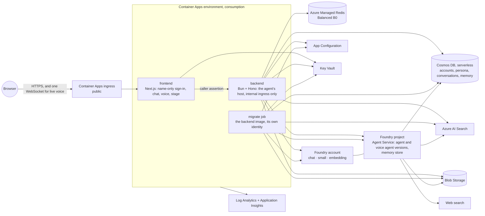
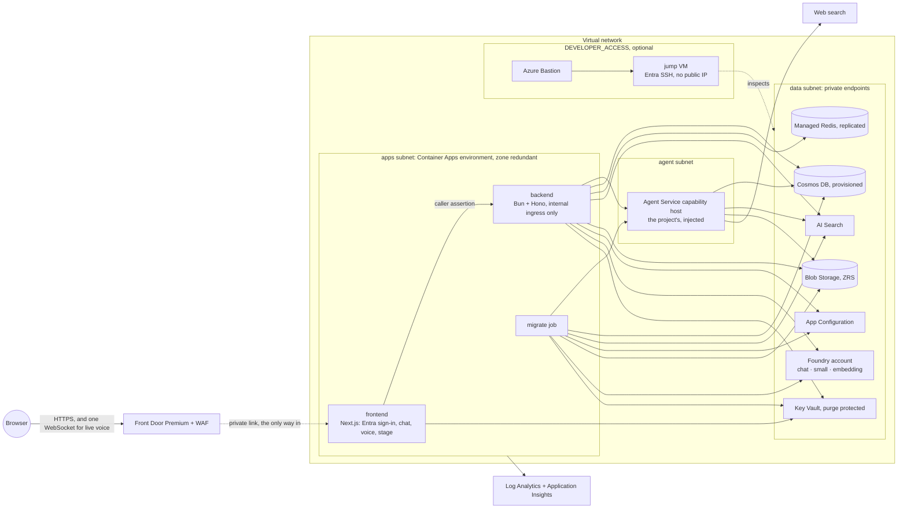
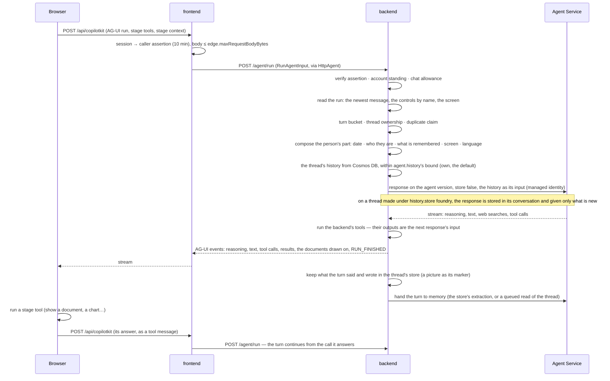
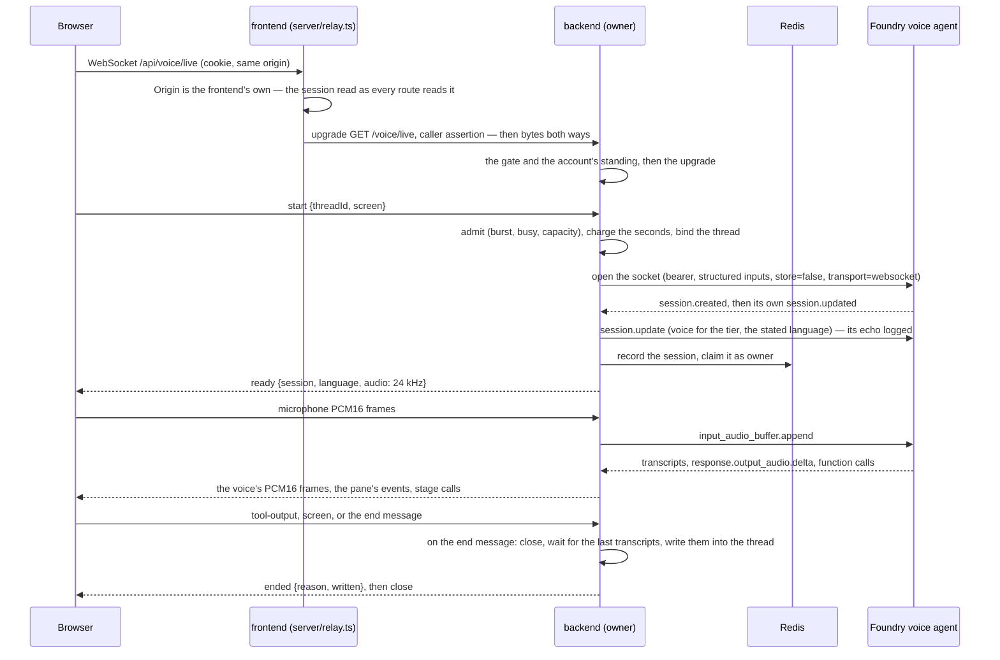
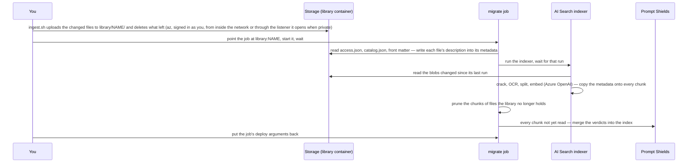
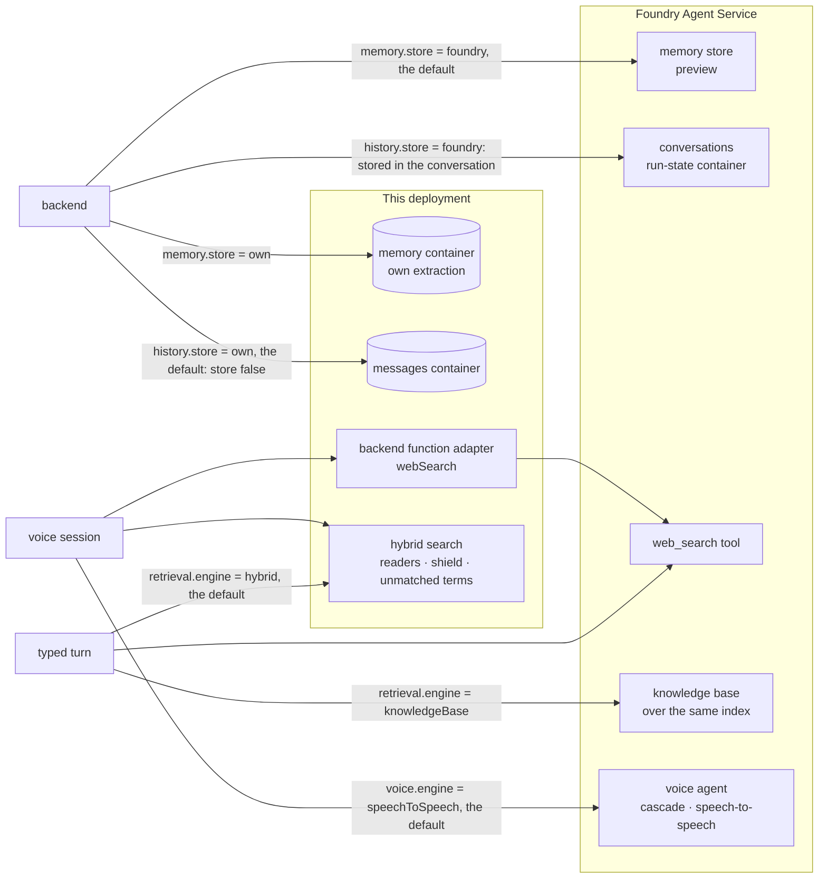

# Architecture

Read this page to learn what Agent on Azure deploys and how a request moves through it. It covers the topology of each mode, the components and their identities, the request flows (a typed turn, retrieval, voice, loading documents, a deploy), the data stores, and which parts the deployment keeps for itself rather than taking from the Agent Service. It is for whoever runs, changes or reviews a deployment. Setting names are in [configuration](configuration.md); what Agent on Azure cannot do is in [limitations](limitations.md).

The deployment is two container apps and one job on Azure Container Apps, in front of managed data and AI services. Every identity reaches those services with Microsoft Entra ID, and none reaches them with a key.

The agent runs on Foundry Agent Service: a prompt agent whose versions hold the fixed parts of the prompt and every tool. Each moving part around it (memory of the person, retrieval, conversation history, web search) is either the service's or the deployment's own, some by a setting. [Foundry's or the deployment's own](#foundrys-or-the-deployments-own) below gives each part's choices and its default.

The backend is the agent's host. It decides who may start a turn and runs the tools the service cannot: the backend's own, and the browser's controls. It keeps each person's conversations in Cosmos DB beside the accounts and the persona: the index of conversations and, by default, every message, sending a turn its history every time. An operator can have new threads kept in the service's conversations instead (`history.store`). The documents are blobs that AI Search's own indexer ingests, each described in its metadata. There is no relational database.

## Topology

One template deploys in two modes; [Azure services per mode](#azure-services-per-mode) below lists what each service is in each. The apps, the job and the services are the same in both. What differs is where the edge is and whether anything has a public listener.

### Demo

`HARDENED=false`, the default: public endpoints, the frontend's own Container Apps ingress as the edge, and a name-only sign-in (`AUTH_MODE=local`) where every sign-in is a new person. The browser reaches the frontend alone; the backend has internal ingress only.

Every service answers on its public endpoint with local authentication off, so the only thing a public endpoint admits is an Entra identity with a role on it.

### Hardened

`HARDENED=true`: Front Door Premium with a WAF is the edge. It reaches the frontend over a private link into the environment, which sits on the `apps` subnet of a virtual network with its public ingress closed. Every data and AI service has a private endpoint on the `data` subnet and its public listener off; the Agent Service is injected into the `agent` subnet, where its [capability host](patterns.md#terms) runs. Sign-in is Microsoft Entra ID with a role required. `DEVELOPER_ACCESS` adds Azure Bastion and a jump VM to the network for a person to inspect the private services; nothing in the data path needs them.

The private DNS zones are linked to the network, so each service resolves to its private address from inside it. The `data` subnet's security group refuses every outbound flow. The `agent` subnet keeps Azure's default outbound access, or, with `AGENT_EGRESS=restricted`, leaves only through a NAT gateway and a security group that admits the private endpoints and four service tags ([decisions](decisions.md#28-the-agent-subnets-egress-open-by-default-a-nat-gateway-and-a-service-tag-allow-list-by-opt-in)). Locks (`CanNotDelete`) sit on Cosmos DB, Storage, Key Vault, AI Search and App Configuration. Each part of the bundle is its own switch ([configuration](configuration.md#deployment-parameters)); one of them, `PRIVATE_NETWORKING`, also decides where memory is kept ([Memory](#memory) below).

## Components

| Component | What it is | Scale |
| --- | --- | --- |
| **frontend** (`apps/frontend`) | Next.js. Sign-in (Auth.js), the workspace, settings and the privacy notice. Holds no data and calls no model. | 0.5 vCPU / 1 GiB, 1–3 replicas (2–3 when zonal), external ingress on port 3000 |
| **backend** (`apps/backend`) | Bun + Hono. Hosts the agent on Foundry Agent Service (`@platform/agent`) and serves it over [AG-UI](patterns.md#terms), voice, retrieval, the knowledge base's pictures, identity, export and erasure. | 1 vCPU / 2 GiB, 1–3 replicas (2–3 when zonal), internal ingress only on port 4111 |
| **migrate job** | The backend's image run as a manual Container Apps job under its own identity. It writes the settings, the search index, the agent's skills, memory store and first versions, and the document libraries. | 0.5 vCPU / 1 GiB, one replica per execution, 30-minute timeout |

- **frontend.** The workspace holds the chat, the voice pane (the voice controls and live transcript) and the stage, the visual workspace beside the conversation where documents, charts and records open. Every API route that serves the product forwards to the backend with a short-lived [caller assertion](patterns.md#terms) minted from the verified session. Two routes do not: Auth.js's own, and `/api/vitals`, which writes a page's web vitals to the replica's log.
- **backend.** Every route requires a caller assertion except `/health`, `/ready`, `/appearance` and `/appearance/logo`: the deployment's look and its logo, which the sign-in page uses.
- **migrate job.** It writes the settings documents and the persona's versions (the shipped text, until an operator publishes one); AI Search's index, data source, skillset and indexer; the product's default skills into Cosmos DB where none of a name is stored; the agent's memory store (when `memory.store` is `foundry`) and first versions; and the document libraries (described, indexed, pruned, shielded). Every write a deploy makes into a data service happens here, inside the network. The one write from outside is a person's own upload of a library to Storage ([loading documents](#loading-documents)). The name dates from when the job ran migrations; renaming it would recreate the job and its identity in every existing deployment.

Both apps scale on HTTP concurrency (14 concurrent requests per replica). The frontend serves sign-in and the browser's API; the browser never reaches the backend.

## Azure services per mode

| Service | Demo (`HARDENED=false`) | Hardened (`HARDENED=true`) |
| --- | --- | --- |
| Container Apps environment | Consumption workload profile, no virtual network | On the `apps` subnet of a virtual network, zone redundant, public ingress closed |
| Edge | The frontend's Container Apps ingress | Front Door Premium with a WAF (Default Rule Set 2.1 in Prevention, Bot Manager 1.0), reaching the frontend over a private link |
| Azure Managed Redis | Balanced B0 on one node, an unsharded database (`NoCluster`), Entra authentication only, access keys off | The same replicated across two nodes, which the service spreads over zones; private endpoint |
| Azure AI Search | `basic`, one replica, semantic ranker on, keys off | The same with two replicas, private endpoint |
| Foundry account (`AIServices`, formerly Azure OpenAI) | S0, four deployments (`chat`, `small`, `embedding`, `realtime`), each with the guardrail `default-indirect`; keys off; system identity. `realtime` is the voice agent's model, speech to speech; transcription and speech are the service's own | The same, private endpoint (registered in the `openai`, `services.ai` and `cognitiveservices` zones), and the Agent Service injected into the `agent` subnet |
| Foundry project `agent` | System identity; connections to Cosmos DB, Storage and AI Search (Entra) and Application Insights, made one at a time because the service conflicts on a project's connections written in parallel; the Agent Service's capability hosts (standard setup) | The same; the account's capability host comes from the injection |
| Cosmos DB for NoSQL | Serverless, Entra only; databases `app` (the deployment's own, declared) and `enterprise_memory` (the Agent Service's) | Provisioned and zone-redundant (`app` autoscales to 1000 RU/s; the service's three containers take 1000 RU/s each), private endpoint, public access off |
| Blob Storage | Standard_LRS, shared keys off, public endpoint | Standard_ZRS, private endpoint (blob), public access off |
| App Configuration | Standard, local authentication off | The same, private endpoint |
| Key Vault | RBAC, soft delete 7 days, no purge protection | Purge protection, private endpoint |
| Container Registry | Basic, admin user off, public (remote builds push to it) | The same |
| Azure Policy | Four built-in audits on the resource group: local authentication off on the Foundry account, Cosmos DB, AI Search and Storage | Eight: the same, and their public network access off ([security](security.md#policy)) |
| Log Analytics + Application Insights | 30-day retention; every resource's diagnostics; public ingestion | The same; `PRIVATE_TELEMETRY=true` opts in to ingestion through an Azure Monitor private link scope (`ampls-…`, private endpoint on `data`) |
| Locks | none | `CanNotDelete` on Cosmos DB, Storage, Key Vault, AI Search, App Configuration |

Each part of the hardened bundle can be overridden on its own; see [configuration](configuration.md#deployment-parameters).

## Request flows

### A typed turn

- The agent version holds the guardrails, the persona, the channel instructions and every tool. The **channel instructions** are the per-channel instructions in `apps/backend/src/product/surface.ts`, in a written register for typed turns and a spoken one for voice. They describe the [stage](patterns.md#terms) and its controls, and name only the server-side tools this turn carries, so the model never calls a tool the turn does not have. A response names the version and carries the person's part of the prompt as a structured input, so nothing a person wrote is ever part of a version. A version is made by the deploy's job, or the first time a turn needs it, and is found again by a hash of its definition.
- Of a run, the backend reads only its newest message (or the answers that end it), the names of the controls the browser registered, and the screen's lines. The conversation is the host's, read from its own history store, or the service's on `history.store: foundry`. A field AG-UI's run does not define, shared state, and a control the backend does not define are a 400 ([security](security.md#the-run-body)).
- The stage's controls (`showLibrary`, `openDocument`, `presentContent`, `showChart`, `showRecord`, `showRecords`, `clearStage`, `suggestNext`) are defined by the backend and run in the browser. The model's call streams to the browser, which updates the stage and answers with a status line. What the agent can place on the stage, a person can open by hand through the same handler:
  - the top bar's Library and Records buttons open the library and the records, as `showLibrary` and `showRecords` with no query (`apps/frontend/app/components/stage-controls.tsx`, registered by the workspace and read by the bar);
  - a records chip is `showRecord`;
  - a card's figure chips read `GET /records/:kind/:id/metrics/:measure`, which is what the `metrics` tool returns, into `showChart`.
- The frontend ships in five languages: `en`, `it`, `es`, `fr`, `de`, one catalog each in `apps/frontend/messages/`. The agent answers in the stated language on both channels. A typed turn's instructions carry a language directive naming it (`platform/agent/src/instructions.ts`). A live session is given the same language as a structured input, and states it as its voice's accent in its `session.update` ([Voice](#voice) below).
- When a turn or a live session ends in a conversation that has no name, the backend queues it to be named a moment later. The queue is `platform/agent/src/coordination/due-queue.ts`, the same wait the deployment's own memory extraction goes through. The name is the small model's title, under the `agent.titles` buckets and a per-replica cap, drawn from the conversation's lines minus any its `blocked` list names; when the model declines, it is the person's first such line. It is written only while the conversation still has no name, so a rename stands. A conversation with nothing but blocked lines stays untitled. The conversation picker reads the list again after a run ends until the name is there.

### Retrieval with the access filter

The `knowledgeSearch` tool and the stage's library call `retrieve` with the caller's verified object id and groups (read from the account row, never the request):

1. A free first check decides whether the question holds anything a filter could act on. If so, the small model drafts a plan (tags, and whether pictures were asked for) that the code validates against the live tag vocabulary.
2. One hybrid query to AI Search: keyword, and vector as text the index's vectorizer embeds, fused and reranked by the semantic ranker, then floored (`knowledge.retrieval.rerankerFloor`) and capped per document (`maxPerDocument`).
3. Every query carries `injection eq false and documentId ne null`, so a chunk Prompt Shields has not read, or has flagged, and a chunk of a blob no load described, is never served. With `access.enforceAccessControl` on, it also carries `oids/any(t: t eq '<oid>') or groups/any(t: search.in(t, '<groups>|all', '|'))`. This is AI Search's generally available security-filter pattern, run under the backend's identity, with `all` among the groups only while `access.globalDocumentAccess` is on. The filter sits outside the plan, so relaxing a plan never drops it. No caller, no rows; a local sign-in matches only `all`, and nothing with it off.
4. A picture in the result is a path in the library container, `/api/media/{library}/{path}`; the backend serves it, by the same rule, to a caller its blob's own readers admit.

### Voice

Voice is one path: a live session with a **Foundry voice agent** (preview), Microsoft's recommended integration of Agent Service and Voice Live. The voice agent hears the person, reasons on the agent's own prompt for the `live` channel, calls the same tools a typed turn has (server and stage), and speaks. A deployment that cannot accept preview terms can opt into the generally available **Voice Live API** directly: the backend opens the same session on a model Voice Live hosts and sends the prompt and tools in its first update, with the broker, the tools, the stage and the record unchanged ([voice runtimes](configuration.md#voice-runtimes), decision 31).

**Engines.** Which engine answers is the `agent` document's `voice.engine`, per tier if `voice.engineByTier` says so.

- `speechToSpeech`, the default, names the Azure OpenAI realtime deployment the template makes (`models.realtime`). The service runs that model as "Native speech-to-speech" ([Configure a voice agent](https://learn.microsoft.com/en-us/azure/foundry/agents/how-to/configure-voice-agent)): it hears the person itself, and the transcriber (the `agent` document's `voice.transcription`) writes only the readable transcript. The answer is spoken in the tier's Azure voice. For a tier the `voice` document gives an OpenAI voice, it is spoken in the model's own voice, with no fillers.
- `cascade` reasons on the `chat` deployment instead, the one typed turns use, and the service runs it as a [cascade](patterns.md#terms): the person transcribed, the chat's model answering in text, the answer spoken in the tier's voice. It is slower to answer and cheaper, with no voice model, and uses the chat deployment's quota as typed turns do.

A version fixes its model, so each engine is a version of the one voice agent. The job's `agent` step makes one for each engine some tier is answered by, the prune keeps each engine's current one, and a session asks for its engine's version by `x-agent-version-override`. Both engines name this deployment's own models by default (`model_type: "self_deployed"`). `voice.managedModel` may name, per engine, a managed model the voice service runs itself (`model_type: "managed"`), which needs no deployment and processes at the service's scope. That is opt-in, from one table of names and capabilities that validation, the tuning panel and the version builder share ([managed voice models](configuration.md#managed-voice-models), decision 25). A managed model is a version of its own, like a realtime model. [Speech-to-speech](patterns.md#terms) chosen with neither a realtime deployment nor a managed realtime model runs the cascade, reported as `agent.voice.speech_to_speech_unconfigured`.

**The connection.** The browser holds one WebSocket to the frontend's own origin, and the frontend's server relays it to the backend under the caller's assertion. The backend holds the voice agent's socket on its managed identity and relays the audio both ways, with the session's events beside it. The browser never reaches Foundry and holds no credential for it, so a hardened project with public access off serves voice as it serves typed turns. The person picks voice or chat for a conversation, never both at once, and what was said is written into the conversation when the session ends.

**Redis is required for live voice.** The voice pane asks `GET /voice/capability`, which says `live` when the product has a voice, the project is configured and a Redis is configured. Without Redis it says there is no voice, and typed chat goes on. Whether Redis answers is checked when a session starts, and the session is refused if it does not.

| | |
| --- | --- |
| Engine | `cascade` or `speechToSpeech` (the default), chosen per session from the tier, failing closed to the cascade (`platform/agent/src/foundry/voice-engine.ts`). Details below. |
| Admission | On `start`, in order: the burst (`limits.realtime`), one session per account (`busy`), the deployment's cap (`realtime.concurrentSessions`), then the seconds charged. Details below. |
| The opening | The service's own `session.updated`, then the person's `session.update`, then the thread so far as items. Details below. |
| Ownership | The replica the browser's socket reached holds both sockets of the session; Redis holds the owner's claim. Details below. |
| Tools | Every function tool of a typed turn, held by the voice agent itself. Details below. |
| Audio | PCM16, mono, 24 kHz both ways, with echo cancellation and noise suppression on both sides. Details below. |
| Bounds | `limits.realtime.*`, `premium.*`, `global.*`. Neither direction buffers without bound: late frames are dropped, and a browser that stops reading is closed. Details below. |
| One channel | A conversation's thread is spoken or typed, never both at once. Details below. |
| Transcript | Text, never audio, written into the thread's history once, when the session ends. The service keeps nothing (`store=false`). Details below. |
| Drain | A replica going away tells each session it holds to reopen, then closes and writes them. Details below. |
| Edge | Container Apps ingress passes WebSockets on both apps. Front Door (hardened) passes them too (generally available), inspecting the handshake with the WAF and nothing after it. Its idle timeout is five minutes, and the audio never lets a session idle. |

**Engine.** `cascade` uses the `chat` deployment, transcribed by `voice.transcription`, its session update carrying the typed turns' `reasoningEffort`. `speechToSpeech` uses the realtime deployment (`AZURE_OPENAI_REALTIME_DEPLOYMENT`), transcribed for the record by `voice.transcription`. When that transcriber is documented only beside a cascade (`azure-speech`), `mai-transcribe` transcribes instead (`agent.voice.transcriber_replaced`). Its update carries `voice.realtimeReasoningEffort` only for a reasoning realtime model (`gpt-realtime-2`, `gpt-realtime-2.1`, `gpt-realtime-2.1-mini`).

**Admission.** The tier sets the session's ceiling: `premium` gets the HD voice and `premium.maxSessionSeconds`. Without Redis the answer is `unavailable`; typed chat is unaffected. A refusal is a message on the socket, `{ type: "refused", status, body }`, as a route would answer it.

**The opening.** The opening runs in this order (`openSession` in `platform/voice/src/voicelive/exchange.ts`):

1. The service announces the session and sends a `session.updated` of its own as it applies the version.
2. The person's `session.update` goes after it. It carries the tier's voice and, with `voice.live.language` `stated`, the person's language for transcription and speech. The voice's accent follows that language; the service transcribes the language it hears.
3. The echo of that update is the next `session.updated`. It also carries the engine's reasoning effort: the typed turns' on the cascade, none for a realtime model that does not reason.
4. The thread so far is added as items (`conversation.item.create`), so the voice continues what was typed. This is all or nothing: if one line is refused, every line is taken out again.

The fillers spoken while a tool call runs come from the version, never from the update. They are `interim_response` of type `llm_interim_response`, trigger `tool`: a line the service's model writes from the conversation, so in the person's language (`INTERIM_INSTRUCTIONS` in `platform/agent/src/foundry/voice-definition.ts`). An update that is not echoed within `voice.live.updateTimeoutMs` opens the session all the same. The service may refuse an update outright, when its settings leave it nothing to run with (`platform/voice/src/voicelive/refusals.ts`). Such an update is refused to the browser as `settings_refused`, and the browser is never told the session is ready. The same refusal after the opening ends the session as `refused`.

**Ownership.** The audio crosses one process and nothing is sticky: a session is one connection. Redis holds the owner's claim, who the session is for and the transcript so far. Redis also keeps the live-voice ledger, the record of sessions and seconds spent, and a periodic sweep over it can end a session from any replica. The sweep leaves the end in Redis, says so on the owner's channel, and reads the owner's claim. An owner that holds its claim ends the session itself, on the channel or at its next heartbeat, which also takes a lapsed claim back. So a quiet channel is never read as a dead owner. A killed owner is noticed by its lapsed claim. The replica that asked then closes the session and writes it from the transcript the owner kept; if the claim was still held at the cutoff, it looks again once the claim's lifetime has passed.

**Tools.** The voice agent holds every function tool of a typed turn.

- A server tool it calls (knowledge search, records, metrics) runs in the backend as the person.
- A stage control goes to the browser and back on the socket, answered `not_answered` after `voice.live.stageCallTimeoutMs`.
- Once every call of a response is answered, the backend asks the voice to go on (`response.create`). That allows up to `foundry.maxSteps` responses a turn, as for a typed turn; past that, the calls are answered and nothing more is asked for (`voice.live.max_steps`).
- An ask that would land while another response is open (one the service's own turn detection opened) waits for that response to end. The service refuses an ask beside an open response and does not remember it.
- A response that fails with nothing said is asked again after a backoff (`voice.live.responseRetry`), each ask a step. Once the asks are spent, the voice is told once, by a system item, to say it could not get the answer, and the voice pane says the same.
- A call to a tool the session does not have is told not to call it again, as on a typed turn.
- The documents a backend tool handed the model since the person last spoke reach the voice pane under the answer as a `sources` event. They are chosen as a typed turn's chips are (`namedSources`), and never shown under a filler or a response that itself retrieved. A response that only drove the stage counts as an answer, as on a typed turn.
- A voice agent can hold web search only through a toolbox that would replace every function tool, so it is one more of the backend's functions ([Tools in a voice session](#tools-in-a-voice-session)). `webSearch` runs a response on the chat's deployment with the typed turns' web search tool, required, with its answer capped and its reasoning set by the `agent` document's `webSearch` settings. It is charged to the same `toolSearch` bucket, checked at each call. The skill reader `readSkill` is the backend's function on both channels ([skills](#skills)).

**Audio.** The browser asks for echo cancellation and noise suppression and runs the microphone through an `AudioWorklet`; the voice agent cancels echo and suppresses noise again. When the person speaks over the voice, the browser clears its playback at once, and the service cancels the answer and leaves its item whole: the version sets `auto_truncate` off. The microphone control at the center of the voice trace mutes the track: the frames still go out and carry silence, and the voice pane says *Muted*. The session and the socket stay open (the backend closes a socket silent for a minute), and the service, which "decides when to commit" in server VAD mode, hears nobody.

**Bounds.** The owner renews a session while someone speaks. It ends when the person ends it, at the idle reclaim, at the ceiling, when the service closes the socket, when either socket goes, or when the sweep ends it.

**One channel.** A live session holds the thread's turn claim until it is closed and written, so a typed turn on that thread is `409 thread.busy` (the voice pane says the session is still closing). While the channel is open, the composer stays under the voice pane and its words go *into* the session: `text` on the socket becomes `conversation.item.create` as the person's `input_text`, then `response.create`, now or once the answer in flight is done. The voice answers, and the words are shown in the voice pane and written into the thread with what was said. Words typed while the session cannot take them (opening, or ended) wait, and go as a typed turn once the channel closes.

**Transcript.** Nothing is written during the session. When it ends, the transcript is written into the thread's history once (`settleLiveVoice`): into its own container, or into the thread's conversation on `history.store: foundry`. It is written as message items whose times the index entry keeps, and the typed turns that follow are given it: the person's words and the voice's, in the order the service gave them.

- A line the person spoke over is the whole reply the model generated, marked (` —`), not what the person heard. Within the session, a speech-to-speech model's context holds that whole reply; the cascade leaves it out of the chat model's context for the rest of the session ([limitations](limitations.md)). The typed turns after the session are given it whole from the thread.
- An answer the content filter stopped is never written. The cascade speaks a refusal under an item of its own; speech-to-speech ends with no output. Either way, the person's lines since the voice last spoke are written and named on the thread's `blocked` list, which memory never reads.

**Drain.** A replica going away reports not ready, tells each session it holds to reopen (`restart`), waits `voice.live.drainGraceMs`, then closes and writes each session. The drain is given 20 s, after which the host is stopped: the turns still streaming are ended, and the queued memory and title work this replica holds is run. That work has six seconds kept for it, whether or not the drain ran to its end. Then everything else is closed at once and the telemetry flushed, each inside a share of its own, so the backend's `terminationGracePeriodSeconds` (30 s) covers it. The frontend drains too: it closes each relayed socket as going away (`1001`) and gives its streams 25 s of the same grace period. The browser offers *Reopen*, and the new session binds the same thread on whichever replica its new socket reaches.

Both agents compose their instructions through the same prompt code, so the guardrails, persona and person blocks (what is remembered among them) are identical on both channels. The job's `agent` step makes the voice agent's version for each engine in use, and fails the deploy when the project refuses one. A backend whose project cannot be asked for the voice agent, because it is unreachable or forbidden, does not become ready. An agent the project simply does not have yet does not hold up the start.

**A tester's session.** An account holding the app role `tester` may tune its own live sessions from Settings ([who tunes voice](configuration.md#who-tunes-voice)). The tuning is a field of the account's document, read and saved through the backend's `/voice/tuning` and applied when that person's session opens, with the role re-read from the account's row each time. Such a session can run a different engine, model, voice or turn detection than the documents name. That can be a second realtime deployment (`models.realtimeAlternate`) where the template made one, or a managed model that processes at the service's scope. It runs as a voice-agent version of the tester's own, made at the first session that asks for it. Nobody else's session is touched.

### Loading documents

See [documents](documents.md).

### A deploy

`azd up` is `azd provision` then `azd deploy`, with hooks:

1. `preprovision`:
   - refuse components that cannot go together, and zones without the network;
   - ask Azure Resource Manager which secrets the vault holds and which services run;
   - generate `AUTH_SECRET` when neither the environment nor the vault has one;
   - register the resource providers the template needs;
   - refuse a region without the realtime model;
   - make the jump host's key with developer access on;
   - record whether the principal is a person or a pipeline;
   - make the Entra app registration for Entra sign-in.
2. Provision `infra/main.bicep` at subscription scope.
3. `postprovision`: add the sign-in callback to the registration; delete a project connection to a knowledge base's MCP endpoint where one is left, and the project's `insights` connection unless `AGENT_TRACING` is on; behind Front Door, approve the private link from the edge to the environment ([the hooks](deployment.md#the-hooks)).
4. Remote-build both images in the registry and roll both apps.
5. `postdeploy`: give an app that holds no health probes the template's (a first provision puts none on the placeholder, and `azd deploy` changes only the image), then point the migrate job at the new image and run `settings index skills agent library` (or `remove-library`) in one execution, waiting for it. A failed step fails the deploy with the job's log.

On a first deploy the backend can start before its Cosmos DB role assignment has applied. It stays live on `/health`, answers 503 on `/ready` and everything else, and starts serving once Cosmos DB admits it. The search index and the Foundry project are waited for the same way when they refuse the backend's identity at start. A refusal still standing after 15 minutes is not lag, and fails the start, so the platform keeps traffic on the previous revision. At start the backend also checks that each Cosmos DB container it uses exists with the partition key its store addresses it by, and refuses to start otherwise. See [deployment](deployment.md#what-a-first-deploy-does).

## Identities and roles

Three user-assigned managed identities, each with its own role list in `infra/main.bicep`. No service the apps reach holds a key: Redis, AI Search, the Foundry account, Cosmos DB, Storage and App Configuration all have local authentication off. Web search is the service's own tool, so the deployment holds no key at all. The project's Application Insights connection carries an ingestion connection string, which identifies the telemetry sink and grants nothing.

| Resource | backend | frontend | migrate job | Operator |
| --- | --- | --- | --- | --- |
| Container Registry | AcrPull | AcrPull | AcrPull | — |
| Key Vault | Key Vault Secrets User | Key Vault Secrets User | Key Vault Secrets User | Key Vault Secrets Officer |
| App Configuration | App Configuration Data Reader | — | App Configuration Data Owner | App Configuration Data Owner |
| Redis | The database's `default` access policy | — | — | The `default` access policy, with developer access on a private deployment, unless the operator is a group |
| Storage | Storage Blob Data Reader | — | Storage Blob Data Contributor | Storage Blob Data Contributor |
| AI Search | Search Index Data Reader | — | Search Service Contributor, Search Index Data Contributor | Search Service Contributor, Search Index Data Contributor |
| Foundry account | Cognitive Services OpenAI User; Cognitive Services User (a live session on Voice Live itself) | — | Cognitive Services OpenAI User, Cognitive Services User (Prompt Shields) | Cognitive Services OpenAI User |
| Foundry project | Foundry User: responses, conversations, the memory store, agent versions a turn needs | — | Foundry User: the memory store, agent versions | Foundry User |
| Cosmos DB | Built-in Data Contributor on `app` | — | Built-in Data Contributor on `app` | Built-in Data Reader; Built-in Data Contributor on `app`, to publish the persona |

The operator is whoever provisions, unless `OPERATOR_PRINCIPAL_ID` names a person or a group. Then every role in that column, and the jump VM's sign-in, is theirs, and the principal that provisions (a pipeline's identity, for example) is assigned none of them. A provision adds assignments and removes none, so a principal that provisioned as the operator before another was named keeps what it was given until it is removed by hand. Provisioning itself is the control plane's, which the deploying role covers.

Two system identities hold roles too, and neither is a person's:

- **The project's**, the Agent Service's own. Its roles live in `infra/modules/agent-service.bicep`, because the service dictates the order:
  - granted before its capability hosts are made: Cosmos DB Operator on the account, Storage Blob Data Contributor, and Search Index Data Contributor with Search Service Contributor;
  - granted after: Built-in Data Contributor on `enterprise_memory` alone, and Storage Blob Data Owner with its tag actions conditioned to the service's own containers;
  - Cognitive Services OpenAI User on the Foundry account, through which the memory store calls `small` and `embedding`. It is granted whichever store `memory.store` names, so changing the setting never needs a provision.
- **AI Search's**, its indexer's: Storage Blob Data Reader, and Cognitive Services User on the Foundry account.

People who sign in hold no Azure role at all: every Azure call is made by one of these identities, and who a person is decides only what is asked for.

Why the split:

- **The index is schema, and ingestion is the job's.** Creating or changing the index, data source, skillset and indexer needs Search Service Contributor, which also reaches the service's settings. So of the three app identities only the job holds it, and only the job writes blob metadata and chunks (the operator and the project's own identity hold their roles in the table above). The backend only reads the index and a picture's blob, so a compromised backend can neither widen a document's readers nor plant a chunk. It checks the index at start and refuses to start on a service it cannot read, waiting out a refusal of its identity as above.
- **The agent is the backend's to run, and the deploy's to prepare.** Both hold Foundry User on the project, scoped to the project and never the account. The backend needs it because a turn makes the version it needs when no deploy made it first, and because it deletes what a person erases. The job needs it to make the memory store and prepare the versions before traffic arrives.
- **Redis** is reached as the backend's object id with an Entra token as the password (`rediss://<objectId>@<host>:10000`), redialed with a fresh token before it expires.
- **Storage** is keyless, and never reached by a browser: the backend reads a picture with its identity and streams it.

## Data stores

| Store | What lives there |
| --- | --- |
| Cosmos DB `app` database | Six containers: `accounts`, `prompts`, `threads`, `messages`, `threadIds` and `memory`, listed after the table |
| Cosmos DB `enterprise_memory` | The Agent Service's own, made by its capability host. On `history.store: own`, the default, the backend writes no conversation to it: every response runs with `store: false`. On `foundry`, a thread made after the change is a conversation there |
| Foundry project | The agent and its versions; the memory store (preview) and, while `memory.store` is `foundry`, the statements it keeps per person. Where the service keeps each is the service's choice; erasure deletes a person's statements through its API |
| Azure AI Search, index `chunks` | One document per chunk the indexer cut: title, summary, text, tags, the vector, the readers (`oids`, `groups`) copied from the file's blob metadata, and Prompt Shields' verdict (`injection`, `shieldedHash`). Beside it, the data source, skillset and indexer that fill it (`chunks-library`, `chunks-skillset`, `chunks-indexer`) |
| Blob Storage `library` | Every library under its name: yours mirrored from your directories by `scripts/ingest.sh`, the sample library as `@sample/`. Each file is described in its own metadata (path, kind, title, summary, tags, readers), and the pictures the media route serves are these blobs. Soft delete keeps a deleted blob 7 days, which is how the indexer sees the deletion |
| Redis | Rate limits, live-voice state, turn claims, work queues and fleet-shared caches, listed after the table. Required for live voice |
| App Configuration | The ten settings documents under `app/` |
| Key Vault | `auth-secret`, `entra-client-id`, `entra-client-secret`, `entra-issuer` |
| Log Analytics | Container logs, request spans, the `problem` and `llm_usage` lines, every resource's diagnostics |

The `app` database's containers:

- `accounts` (`/id`): one document per person (id, email, name, about, preferences, roles, groups, standing, sign-in times, and a voice tester's saved tuning).
  - An account being erased is emptied to its id and shut until what is held under it has been swept.
  - An erased account's document is its id and the time of the erase, and carries its own time to live, eight hours and eleven minutes. This is the one container whose documents may expire; the backend refuses to start on a container that keeps no lifetimes.
  - An erased, deactivated account's document is emptied to its id, the deactivation and the time, and stays.
- `prompts` (`/key`): the persona's versions, one active; and, under the key `skills`, every skill's versions, one active per skill.
- `threads` (`/resourceId`): the index of each person's conversations, with the title and when it was last said to.
- `messages` (`/resourceId`): every conversation's history on `history.store: own`, one document per message, tool call or output, in order, a picture only as its marker. Only the thread id and the order are indexed.
- `threadIds` (`/id`): the claim that makes a thread id one person's.
- `memory` (`/resourceId`): what is remembered about each person while `memory.store` is `own`, one document per statement, nothing indexed. The container is made and checked at start whichever store is chosen.

What Redis holds:

- rate-limit buckets and the live-voice seconds ledger;
- for each live session: its owner claim, who it is for, the transcript so far (kept until its key expires when the thread could not be written), an end left for its owner, and the one channel its owner listens on;
- turn claims;
- the queues of threads waiting for memory extraction and for a title;
- the cached agent-version lookup and its lock;
- the memory updates a forget waits for, and the forget requests still being finished;
- the fleet-shared caches of settings and per-person reads.

Live voice says there is no voice without Redis. Every other use names a fallback, but a configured Redis that never answers stops the backend from starting.

## Foundry's or the deployment's own

Six parts around the agent can be the Agent Service's or the deployment's own. Each choice is a setting or an integration point, not a rewrite. Every known limitation, with its evidence, is in [limitations](limitations.md).

| Part | The deployment's own | Foundry's | Default | Setting |
| --- | --- | --- | --- | --- |
| Memory of the person | `own`: a `memory` container in the `app` database, filled by the backend's own extraction | `foundry`: the Agent Service's memory store (preview) | `foundry` on a public deployment, `own` under `PRIVATE_NETWORKING` | The `agent` document's `memory.store` |
| Retrieval | `hybrid`: the backend's query over the index, with the readers clause, the shield filter and the unmatched terms | `knowledgeBase`: a Foundry IQ knowledge base over the same index, asked by the backend's `knowledgeSearch` on its `retrieve` route for both channels, never as the service's `mcp` tool (decision 27) | `hybrid` | The `knowledge` document's `retrieval.engine` |
| Conversation history | `own`: the `messages` container; every response runs with `store: false` | `foundry`: the service's conversations, one per thread, each typed response stored in it; a live session's spoken lines are written into it by the backend, since the voice agent's own store would keep a separate conversation with the audio (decision 15, [limitations](limitations.md)) | `own` | The `agent` document's `history.store`, for new threads: each thread keeps the store it was made in |
| Voice engine | — | The voice agent, either way: `speechToSpeech` names an Azure OpenAI realtime deployment, which the service runs natively speech-to-speech; `cascade` names the `chat` deployment, one model for typed and spoken turns | `speechToSpeech` | The `agent` document's `voice.engine`, and `voice.engineByTier` per tier; `speechToSpeech` runs only with `models.realtime` deployed, the cascade otherwise |
| Web search | — | The service's `web_search` tool: run inside the response on a typed turn, through the backend's `webSearch` function in a voice session | Foundry's | `webSearch` in the `tools` document's `enabled_tools` switches it off |

The documents under a reply (`sources`) are the same event on both retrieval engines and both channels; a knowledge base's citations are chunk documents on the index, which the backend resolves to library documents.

### Memory

`memory.store` in the `agent` document ([configuration](configuration.md#agent)) names where what is remembered about a person is kept.

- `foundry`, the default, is the Agent Service's memory store (preview). The backend hands each finished turn's words to the store under one scope per account, and the service extracts the statements after `memory.updateDelaySeconds`. The backend reads them into every turn, lets the person correct and remove them, and deletes the scope at erasure. Bookkeeping in Redis makes a forget final while an update is still pending.
- `own` is the `memory` container in this deployment's `app` database. A finished turn's thread is queued; after the same delay, the backend reads its latest messages back with what is kept, and asks the `small` deployment once for the list to keep.

One interface, one Settings page and one erase path serve both. The backend reads the setting at its first use of memory and runs that store for the life of the process. The store's limits (100 scopes per memory store, so one store serves at most 100 accounts; preview) and the reasons to choose either are in the configuration table.

The default depends on the deployment: `foundry` on a public deployment, `own` under `PRIVATE_NETWORKING`. The memory store's extraction runs outside the customer network. The service calls the account's `small` and `embedding` deployments over the account's public endpoint, from Microsoft's own address ranges. Learn's memory page says so under *Limitations*: "Virtual network (VNet) integration isn't supported for memory stores." ([What is memory?](https://learn.microsoft.com/en-us/azure/foundry/agents/concepts/what-is-memory)). With `PRIVATE_NETWORKING` the Foundry account's public access is off, so every one of those calls is refused (`403 Public access is disabled`). The update never completes, and nothing is remembered while nothing reports a failure.

So the template tells the backend (`PRIVATE_NETWORKING`), and the compiled-in default and the seeded `agent` document say `own` there. A document that names `foundry` anyway is refused under `agent.memory.store_unreachable_private`:

- before provisioning, by `preprovision` (as `MEMORY_STORE`);
- in the deploy, by the job's `settings` step;
- after the deploy, by the backend's own choice of store, which then runs the own store.

The background task that finishes forget requests also looks up every hand-over once it is past its delay and the extraction grace period. It reports `agent.memory.extraction_stalled` for one the service has not completed, so an extraction that stops working shows in the log rather than as an empty Settings page.

### Conversation history

`history.store` in the `agent` document ([configuration](configuration.md#agent)) names where a new thread's messages are kept, and the thread's index entry records it. Every read, turn, live session, delete and erasure of a thread goes to the store it was made in (`platform/agent/src/history/`), so a change to the setting strands nothing and needs no restart.

`own`, the default, is this deployment's `messages` container. Every response runs with `store: false` and is given the thread's history within `history.maxItems` and `history.maxChars`, and a live voice session is given the thread's earlier turns from the same store. A picture a person attaches is input to its own turn only and written nowhere; the history keeps a marker in its place.

`foundry` is the service's conversations: the standard agent setup writes them into the deployment's own Cosmos DB account (the `enterprise_memory` database, the project's run-state container). Each response is stored in the thread's conversation and given only what is new, and the service truncates the context. The service keeps no time on an item and has no list of a person's conversations. So the index entry keeps each shown message's time, every response's id, and every conversation the thread had before one expired.

Two behaviors of that container, neither documented, are why it is not the default ([limitations](limitations.md)):

- An API delete (of each item, then the conversation) removes them from what the API answers, but leaves their documents in the container until its time to live, a picture's base64 among them. The [recovery guide](https://learn.microsoft.com/en-us/azure/foundry/how-to/agent-service-operator-disaster-recovery) does not support removing them by hand, so an erasure there reaches what the API answers, not every copy.
- A conversation expires 60 days after it was made, whatever its activity, although the service's FAQ says data "persists unless you explicitly delete it". The next turn renews it (`agent.history.conversation_expired`) and goes on without the earlier messages.

A picture enters the conversation with its turn. Its item and the response it went to are deleted once the turn has answered, as a best effort. See [privacy](privacy.md).

### Tools in a voice session

A typed turn's version carries the service's own `web_search` tool, run inside the response. A voice agent can hold either individual function tools or one toolbox, not both ([configure a voice agent](https://learn.microsoft.com/en-us/azure/foundry/agents/how-to/configure-voice-agent)). The stage controls are function tools that round-trip to one person's browser over the socket the backend holds, so the voice agent holds function tools. Web search reaches it as one more of the backend's functions: `webSearch` runs a response on the chat deployment with the typed turns' `web_search` tool (`platform/agent/src/foundry/voice-tools.ts`).

The session's `interim_response` covers the search's wait with a fixed phrase in the person's language. Packing every voice tool into one toolbox instead would need a route from the service back to the right person's browser for the stage controls. That approach is untested on a hardened project, so the deployment uses the function adapter.

### Skills

A skill is the procedure behind one kind of question, read only on the turns that ask it. Skills are versioned documents in Cosmos DB beside the persona (the `prompts` container, key `skills`), one active version per skill, and each version holds the skill's description ("use when"), its instructions, the `surfaces` and `requiresTools` that gate it, and whether it is enabled. The product's defaults in code only seed a deployment ([managing skills](operations.md#managing-skills)).

Both channels read a skill through one function tool of the backend's, `readSkill` (`platform/agent/src/skills/skills.ts`). The skills that fit a turn (enabled, on its surface, with a required tool switched on, and `skills_enabled` on in the `tools` document) are listed in the tool's description by name and "use when" line, and the tool answers a skill's instructions from the active version. A typed turn has it as a server tool, a live session as one of the voice agent's function tools. The list is part of the agent version a typed turn runs on, so adding, removing or redescribing a skill is one new version, and an edit to a skill's instructions alone is none. The backend reads the active versions at most every 30 seconds, and serves the defaults while none is stored or Cosmos DB cannot be read.

The service's own skills (preview) are not used: a prompt agent version that pinned one did not offer it to the model, and the voice agent can hold one only through a toolbox.

### Retrieval

`retrieval.engine` in the `knowledge` document ([configuration](configuration.md#knowledge)) names what answers a search, typed or spoken; both channels run it through the backend's `knowledgeSearch` function.

`hybrid`, the default, is the backend's own query over the `chunks` index. Vector and keyword results are fused, reranked, floored and capped per document. They are filtered to the chunks Prompt Shields found clean and, under access control, to the caller's readers, and the question's unmatched words are reported.

`knowledgeBase` is the service's own engine over the same index ([documents](documents.md#retrieval-through-a-knowledge-base)).

- The job makes a search-index knowledge source and one knowledge base beside the index. The base carries the planning deployment the template makes with `KNOWLEDGE_BASE=true`, whenever there is one.
- `knowledgeSearch` asks the base's `retrieve` route with the backend as the caller, over the search private endpoint. It carries the effort the channel's setting names (`retrieval.reasoningEffort`, `retrieval.voiceReasoningEffort`) on the call.
- It then reads the chunks the base chose by key under the served filter, in the base's order (`knowledgeBaseSearch` in `platform/knowledge/src/knowledge-base/search.ts`).
- The search service calls the planning model as its own identity, on the route its vectorizer already takes.

One decision answers both channels (`knowledgeBaseRetrieval`). With `access.enforceAccessControl` on, both channels ask the base with the caller's readers clause as a filter, and the read-back applies it again. A spoken search's passages and sources are a typed one's. The base is never the agent's own `mcp` tool, on either channel. That tool fails on a voice agent with the account's public access off, takes no per-call effort, and hands the model chunks neither filter has read ([decisions](decisions.md), decision 27; [limitations](limitations.md)).

The `sources` event under a reply is decided once, at the end of the turn, for both engines. Of every document the retrieval handed the model, it lists the ones whose title the reply's text names (case-insensitively, reading past Markdown emphasis), or all of them when it names none (`platform/agent/src/turn/named-sources.ts`, `finishEvents` in `platform/agent/src/foundry/turn/loop.ts`). What a person sees of it is in [documents](documents.md#a-library).

## The agent integration point

The backend holds an `AgentHost` ([`platform/agent`](../platform/agent/README.md)) and nothing else: starting a turn, listing and reading threads, binding and closing a live voice session, reading and correcting what is remembered, erasing a person. The implementation is on Foundry Agent Service. The typed channel's wire protocol is AG-UI, served by the backend itself over `startTurn` (`@platform/agent/agui`), so it does not change with the host. A product supplies its words and tools through one contract, `AgentProduct`; in Agent on Azure that is `apps/backend/src/product.ts`.

Another implementation is a class implementing `AgentHost`, constructed from the same `AgentProduct`. To be accepted it must pass the [parity suite](patterns.md#terms), `describeAgentHostParity` in `@platform/agent/parity`, which runs the same behavioral tests against any implementation ([extending](extending.md#a-second-agent-host)).
