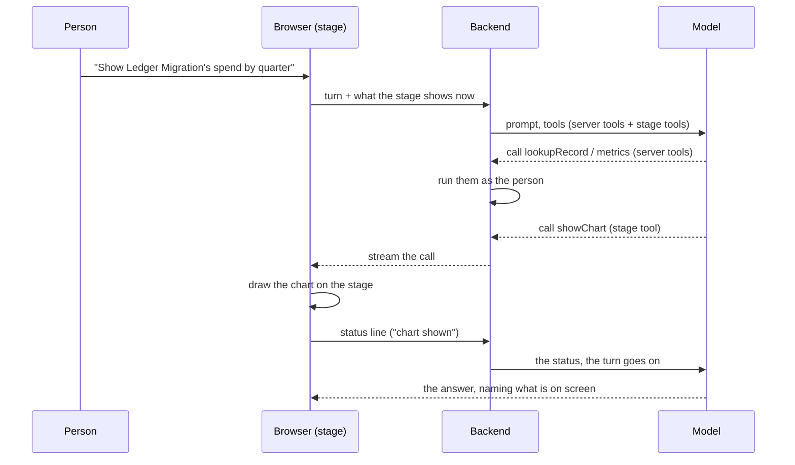
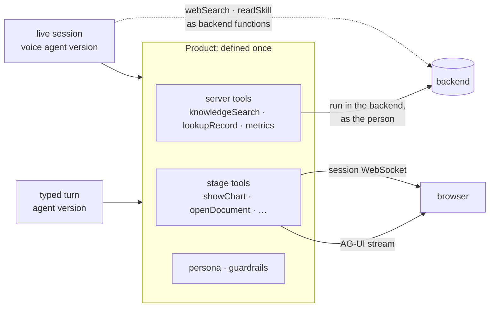
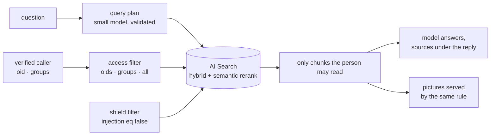
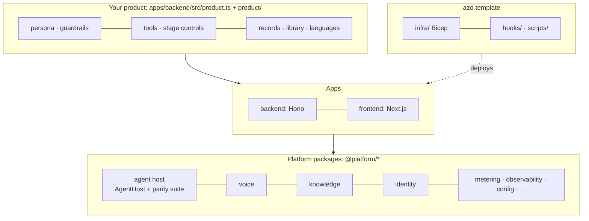

# Patterns

A pattern here is a repeatable practice for an agentic application: a problem every such application meets, the rule that answers it, and the code that holds the rule. Agent on Azure is a working application built from these patterns, so each one can be read, run and tested. They are written to outlive this codebase: the rule is the reusable part, and the files are one implementation of it on Azure and Microsoft Foundry.

Each pattern is defined the same way. **The problem** says what goes wrong without it. **The pattern** states the rule. **Where it is** names the code, the test that holds it where there is one, and the page that goes deeper. What ships as working parts, and what you adapt in each, is listed under [what comes assembled](#what-comes-assembled); the patterns ship together as one application, not as separately installable modules.

## The catalog

| Pattern | The rule |
| --- | --- |
| **Interaction** | |
| [Conversation-driven UI](#conversation-driven-ui) | The assistant shows its answer on a stage through tools the browser runs, and a person can open the same views by hand through the same handler |
| [One set of tools for voice and text](#one-set-of-tools-for-voice-and-text) | A tool is defined once and every channel calls it, as the same person, under the same checks |
| [Brokered live session](#brokered-live-session) | The browser's realtime connection ends at your backend, which holds the provider's connection and its credential |
| **Trust** | |
| [Caller from the session](#caller-from-the-session) | Who a tool acts for comes from the verified session, never from the model's arguments or the request body |
| [Permission-aware retrieval](#permission-aware-retrieval) | The access restriction is a filter on the query, built from the verified caller, where neither the prompt nor the model can relax it |
| [Content screened before it is served](#content-screened-before-it-is-served) | Retrieved text is screened for injected instructions when it is loaded, and a passage with no clean verdict is never handed to the model |
| [Prompt in fixed layers](#prompt-in-fixed-layers) | Guardrails, then persona, then the person; what a person wrote is quoted data and never part of the agent's definition |
| [Server-owned turn](#server-owned-turn) | The client sends the new message and nothing else; the server holds the history, the instructions and the tool definitions |
| **Running it** | |
| [Definitions pinned by content hash](#definitions-pinned-by-content-hash) | An agent definition is a version found by the hash of its content, and every response and session names its version |
| [Bounded turns](#bounded-turns) | Every turn passes a spend bound before the model is reached, and its steps, searches and waits each have a limit an operator can change |
| [Swappable parts behind a setting](#swappable-parts-behind-a-setting) | Each part around the agent is the service's or your own behind one interface, and a combination that cannot work is refused before it is deployed |
| [Procedures as data](#procedures-as-data) | The procedure for one kind of question is a versioned document the model reads through one tool, only on the turns that need it |
| [Erasable by design](#erasable-by-design) | Everything about a person is kept under one id, in stores a delete actually reaches, and erased by one path |
| [Telemetry without the conversation](#telemetry-without-the-conversation) | Refusals and model calls are recorded as codes, counts and timings, never as text |
| **Structure** | |
| [Product separated from platform](#product-separated-from-platform) | What makes the assistant yours sits in one layer, above packages and a template that know nothing of it |
| [Runtime behind a contract](#runtime-behind-a-contract) | The agent service sits behind one interface, with a behavioral suite any other implementation must pass |
| [Settings with a safe fallback](#settings-with-a-safe-fallback) | Operators tune a running deployment through validated documents; a bad value falls back to the code's default and never removes a bound |

## Interaction

### Conversation-driven UI

**The problem.** In a chat-only UI the answer is all text. A chart, a document page or a customer record described in prose is harder to check than one put on screen. And a UI that only the assistant can drive leaves people with no way to get there themselves.

**The pattern.** A **stage** sits beside the conversation. The assistant drives it with *stage tools*: function tools the backend defines, the model calls, and the browser runs. Each one changes what the stage shows and answers with a short status line, so the model knows what the person can now see.

- **By hand.** The library, the records, a document, a record and a record's figures also open by hand: from the top bar's Library and Records, a document card or source chip, a record chip, or a figure chip on a record card. Opening by hand runs the same handler as the tool, so the two routes cannot drift apart.
- **Only from the assistant.** A picture in the media section, a chart of several series, and a searched library or filtered record list. By hand, a picture in the reader opens enlarged.
- **Back to the model.** What is on screen goes to the model on the next turn as a few lines of context, so "show me the second one" works.

**Where it is.**

- **The stage tools** are data, in [`apps/backend/src/product/stage-tools.ts`](../apps/backend/src/product/stage-tools.ts). The backend serves the list to the browser and to the model, on both channels.
- **The handlers** that run them in the browser are in [`apps/frontend/src/stage/tools.ts`](../apps/frontend/src/stage/tools.ts). The state they change is in [`stage.ts`](../apps/frontend/src/stage/stage.ts).
- **Opening by hand:** the top bar's Library and Records go through [`apps/frontend/app/components/stage-controls.tsx`](../apps/frontend/app/components/stage-controls.tsx); the chips on cards go through the workspace's actions ([`apps/frontend/app/(app)/workspace/Workspace.tsx`](../apps/frontend/app/(app)/workspace/Workspace.tsx)). Both call the stage tools' own handlers. The routes behind it are [`record-routes.ts`](../apps/backend/src/product/record-routes.ts) and [`library-routes.ts`](../apps/backend/src/product/library-routes.ts).
- **What the model is told is on screen** comes from [`apps/frontend/src/stage/live-context.ts`](../apps/frontend/src/stage/live-context.ts).
- **The whole typed turn** is in [architecture](architecture.md#a-typed-turn), and adding a control in [extending](extending.md#a-stage-tool).

### One set of tools for voice and text

**The problem.** A voice assistant and a chat assistant built separately end up with two tool sets, two prompts and two permission models, and they drift apart. A tool that looks up a record has to run as the person on both channels, with the same checks.

**The pattern.** Each tool is defined once, in the product. A typed turn runs on the agent's version. A live session runs on a Foundry voice agent's version, and both versions carry the same function tools and are built from the same prompt code. A **server tool** (search, record lookup) runs in the backend in the person's scope, whichever channel called it. A **stage tool** goes to the person's browser: over the AG-UI stream on a typed turn, and over the session's WebSocket on a live one. The voice agent can't hold the service's web search tool next to function tools, so web search reaches voice as one more backend function, and skills reach both channels through one backend function, `readSkill`. The tools and their checks are the same on both channels. What a realtime voice model supports can differ from the typed agent (tools, fillers, voices), as [limitations](limitations.md) records, so acceptance checks both ([voice and text behave the same](acceptance.md#voice-and-text-behave-the-same)). What was said is written into the same conversation, so a typed turn can pick up where the voice left off.

**Where it is.**

- **Defining a tool** uses `productTool` in [`platform/agent/src/contract/product.ts`](../platform/agent/src/contract/product.ts). The sample's tools are in [`apps/backend/src/product/tools/`](../apps/backend/src/product/tools/lookup-record.ts).
- **Who is calling** comes from `currentTurn()` in `@platform/agent`, which gives the verified account, groups and tier, never the tool's input.
- **The voice side** is [`platform/agent/src/foundry/voice-definition.ts`](../platform/agent/src/foundry/voice-definition.ts) (the version) and [`voice-tools.ts`](../platform/agent/src/foundry/voice-tools.ts) (the backend's web search function; the skill reader, both channels', is [`skills/skills.ts`](../platform/agent/src/skills/skills.ts)). The session itself is in [`platform/voice/src/voicelive/exchange.ts`](../platform/voice/src/voicelive/exchange.ts).
- **The full voice flow** is in [architecture](architecture.md#voice), with [tools in a voice session](architecture.md#tools-in-a-voice-session).

### Brokered live session

**The problem.** A realtime voice service wants a long-lived connection and a credential. A browser that connects to it directly holds a token for it, can send its own instructions and tools, and cannot reach a service whose public access is off.

**The pattern.** The browser holds one WebSocket to the application's own origin. The backend holds the provider's connection on its own identity and relays the audio both ways. The session's instructions, voice, language and tools are set by the backend from the verified caller; the browser may send audio, the answer to a control it was asked to run, its screen's lines, typed words and the end, each bounded in size and in rate. Neither direction buffers without bound. One replica owns a session, a shared store holds the owner's claim, and a replica going away tells its sessions to reopen.

**Where it is.**

- **The relay** from the browser is [`apps/frontend/server/relay.ts`](../apps/frontend/server/relay.ts); **the broker** is [`platform/voice/src/broker/broker.ts`](../platform/voice/src/broker/broker.ts), with ownership in [`owner.ts`](../platform/voice/src/broker/owner.ts).
- **What one session may send** is bounded in [`input-budget.ts`](../platform/voice/src/broker/input-budget.ts).
- **The reasoning** is in [decisions](decisions.md#2-one-voice-path-the-browsers-websocket-to-the-backend-the-backends-to-the-voice-agent), the flow in [architecture](architecture.md#voice), and what a browser may send in [security](security.md#live-voice).

## Trust

### Caller from the session

**The problem.** A tool that takes "which user" as an argument lets the model choose whose data it reads, and a model can be talked into choosing. A request body that names an account does the same for anyone who can write a request.

**The pattern.** Identity enters once, from the verified session, and is carried to every tool outside the model's reach. The host runs each tool inside the turn's scope, and the tool asks the scope who is calling: the account, its groups and its tier. No tool has a parameter that names a person. Anything that spends or reads re-reads the account's standing at the point of use, so a deactivation holds at once. People hold no role on the services behind the application: every call is made by the application's own identity, and who the person is decides only what is asked for.

**Where it is.**

- **The scope** is `currentTurn()` in [`platform/agent/src/turn/scope.ts`](../platform/agent/src/turn/scope.ts).
- **The assertion** that carries the caller from the frontend to the backend is in [`platform/identity/src/assertions.ts`](../platform/identity/src/assertions.ts), and the account's standing in [`standing.ts`](../platform/identity/src/standing.ts).
- **The gates in order** are in [security](security.md#gates).

### Permission-aware retrieval

**The problem.** If the assistant answers from a shared index, it can quote a document the person may not open. Prompt instructions ("don't reveal HR files") don't enforce anything. The restriction has to live in the query, and in everything that serves what the query found, such as pictures.

**The pattern.** Every document's readers (Entra user and group object ids) are stored on its chunks when the library is loaded. With `enforceAccessControl` enabled, each search carries a filter built from the caller's **verified** identity, read from their account row and never from the request or the model. The filter sits outside the model's query plan, so relaxing the query cannot remove the access restriction. The same access rule applies to document and picture reads. Chunks that Prompt Shields hasn't checked, or has flagged, are not served. An unidentified caller is refused under enforcement. [Adapting](adapting.md#what-you-change-and-what-it-costs) explains the operational choices.

**It is a switch, on by default for a fresh hardened deployment.** The readers are recorded at every load, but the filter is applied only while the `access` document's `enforceAccessControl` is `true`. A new hardened deployment is seeded with it `true` and a demo with `false`; a deployment that already stores the document keeps its value. The sample library opens for anyone who signs in either way, since its `access.json` gives every file to `all`. On a demo, turn it on before you load anything restricted ([documents](documents.md#who-may-read-a-document)); a load that names readers while it is off says so.

**Where it is.**

- **The filter** is `accessFilter` and `servedFilter` in [`platform/knowledge/src/query/access.ts`](../platform/knowledge/src/query/access.ts). The query is in [`retrieve.ts`](../platform/knowledge/src/query/retrieve.ts).
- **The proof** is [`readers.library.test.ts`](../platform/knowledge/src/query/readers.library.test.ts). Two people in different groups each find their own document and never the other's, whether by search, by id or by picture.
- **Who may read what** is set by `access.json` and the two switches, described in [documents](documents.md#who-may-read-a-document). [Security](security.md#who-may-read-a-document) explains why the backend filters itself rather than using Foundry's search tool.

### Content screened before it is served

**The problem.** A retrieved passage reaches the model as a tool's output, with the authority of something the application chose to show it. A document that carries instructions ("ignore the above and…") is an attack on every person whose question retrieves it, and a filter on the prompt does not read a tool's output.

**The pattern.** Screening is a step of loading, not of answering. Every passage is read by an injection classifier when its library is loaded, and the verdict is stored on the passage with a hash of the text it was given on. Every query asks only for passages with a clean verdict, so the rule fails closed: a passage not yet read has no verdict and is not served, and a passage whose text changed is read again. Screening reflects the classifier's result; it is not a guarantee that every attack is detected.

**Where it is.**

- **The scan** is [`platform/knowledge/src/shield/scan.ts`](../platform/knowledge/src/shield/scan.ts), run by the deploy's job after each indexer run.
- **The filter** every query carries is `servedFilter` in [`platform/knowledge/src/query/access.ts`](../platform/knowledge/src/query/access.ts).
- **What it covers and the window it leaves** are in [security](security.md#model-safety).

### Prompt in fixed layers

**The problem.** A prompt assembled by concatenation gives every part the same authority. A person's "about me" text, a remembered statement or a line describing the screen can then countermand the rules, and an agent definition that contains anything about a person is a definition per person.

**The pattern.** The prompt has three parts in one fixed order: the guardrails, the persona with the channel's instructions, then the person. The guardrails come first and say by name what they outrank. Everything a person wrote, what is remembered about them and what is on their screen are quoted, bounded blocks, framed as something to pitch an answer by. The agent's definition holds only the first two parts, so it is the same for everyone; the person's part travels with each response as a structured input. Template markers are broken in both halves, so neither an operator's persona nor a person's words can name a variable. Guardrail wording is tunable, and a slot that fails validation falls back to the shipped wording, so no edit leaves a guardrail empty.

**Where it is.**

- **The order and the map** between the parts are in [`platform/prompt/src/compose.ts`](../platform/prompt/src/compose.ts); the person's blocks in [`personalization.ts`](../platform/prompt/src/personalization.ts); the quoting in [`scrub.ts`](../platform/prompt/src/scrub.ts).
- **Both channels** compose through this code, so a spoken turn and a typed one run under the same guardrails.
- **What it defends against** is in [security](security.md#model-safety), and what reaches the model in [privacy](privacy.md#what-reaches-the-model).

### Server-owned turn

**The problem.** Chat protocols let a client resend the whole conversation, and many servers forward it. A client that can write the history can write a system message, redefine a tool or name another model.

**The pattern.** The server holds the conversation. Of a run, it reads the conversation's id, the newest message (or the answers to the controls the browser ran), the names of those controls, and the screen's lines. The earlier history is read from the server's own store, so a message a client wrote into it is inert. A control reaches the model in the server's own words, by name. A field the protocol does not define, shared state and a control the server does not define are refused, not dropped: the application's own client sends none of them, so one is a probe. A retry of the same message is the same turn, claimed once.

**Where it is.**

- **Reading a run** is [`platform/agent/src/agui/input.ts`](../platform/agent/src/agui/input.ts).
- **The claim** that makes a retry the same turn is in [`platform/agent/src/coordination/idempotency.ts`](../platform/agent/src/coordination/idempotency.ts).
- **What is accepted and refused** is in [security](security.md#the-run-body).

## Running it

### Definitions pinned by content hash

**The problem.** An agent's prompt and tools change with a deploy, while turns and live sessions are in flight. Several replicas making "the current agent" at once make several, and two agents written from one source (typed and voice) drift apart unless something holds them equal.

**The pattern.** A definition is content, and its version is found by the hash of that content. The deploy publishes a version when the hash moves and prunes old ones. A turn that needs a version nobody made yet makes it, with one replica asking the service and the rest waiting for its answer. Every response and every session names its version, so a session opened before a deploy finishes on the version it started with.

**Where it is.**

- **Finding and making a version** is [`platform/agent/src/foundry/versions.ts`](../platform/agent/src/foundry/versions.ts); the hash is `definitionHash` in [`definition.ts`](../platform/agent/src/foundry/definition.ts).
- **The reasoning** is in [decisions](decisions.md#16-agent-versions-are-pinned-by-content-hash).

### Bounded turns

**The problem.** An agent loops: each tool call is another model call, a search can run long, and a person, or a script signed in as one, can start turns without end. Without bounds, cost and latency are whatever the model and the caller make them.

**The pattern.** Every way a turn can grow has a limit, and each limit is a setting. A turn passes three guards before the model is reached, cheapest first: the account's spend bound, the conversation's ownership, and the duplicate claim. Inside the turn, the number of model responses is capped, each tool that costs has an allowance of its own, and each search has a deadline. When a limit is reached the turn degrades and says so: it runs without web search, the last step's calls are still answered, a refusal carries when to try again. A live session is admitted, charged by the second and ended at its ceiling by the same ledger. A refusal is counted ([telemetry without the conversation](#telemetry-without-the-conversation)).

**Where it is.**

- **The guards** are `admitTurn` in [`platform/agent/src/turn/admit.ts`](../platform/agent/src/turn/admit.ts).
- **Allowances and the live-session ledger** are [`platform/metering`](../platform/metering/README.md).
- **The numbers** are the [`limits`](configuration.md#limits) document and `foundry.maxSteps` in the [`agent`](configuration.md#agent) document; [operations](operations.md#metering-and-premium) covers tuning them.

### Swappable parts behind a setting

**The problem.** An agent platform offers its own memory, conversation store, retrieval and voice engine. Each is the fastest way to start, and each has limits (a preview, a retention rule, a network it cannot reach) that some deployments cannot accept. Code written straight against one of them makes the choice permanent.

**The pattern.** Each part around the agent has one interface and two implementations, the service's and the application's own, chosen by a setting. A record remembers which store it was made in, so changing the setting strands nothing. Which piece does a job is chosen at deploy time; tuning stays a run-time setting. Combinations that cannot work are listed in one table and refused at three points: before provisioning, in the deploy, and at run time for an edit made since. A refusal at deploy time is seen by the person who can fix it, where a silent substitute at run time is seen by nobody.

**Where it is.**

- **The interfaces** are [`memory/interface.ts`](../platform/agent/src/memory/interface.ts) and [`history/interface.ts`](../platform/agent/src/history/interface.ts) in `platform/agent`.
- **The table of combinations** is [`apps/backend/src/components.ts`](../apps/backend/src/components.ts).
- **Each part's choices and default** are in [architecture](architecture.md#foundrys-or-the-deployments-own), and the reasoning in [decisions](decisions.md#26-components-are-chosen-at-deploy-time-tuning-at-run-time).

### Procedures as data

**The problem.** The steps for one kind of question ("how to compare two quarters") do not belong in a prompt every turn pays for, and a change to them should not need a deploy.

**The pattern.** A procedure is a skill: a versioned document with a "use when" line, its instructions, and the channels and tools it needs. The model sees only the names and "use when" lines, in the description of one tool, and calls that tool to read a skill's instructions on the turn that needs them. Because it is an ordinary function tool, every channel reads skills the same way. Editing a skill's instructions changes no agent definition; the defaults in code only seed a deployment and are served when the store cannot be read.

**Where it is.**

- **The reader** is `readSkill` in [`platform/agent/src/skills/skills.ts`](../platform/agent/src/skills/skills.ts); the store is [`platform/prompt/src/store/skill-store.ts`](../platform/prompt/src/store/skill-store.ts).
- **Writing one** is in [extending](extending.md#a-skill), and managing them in [operations](operations.md#managing-skills).

### Erasable by design

**The problem.** An agentic application keeps a person's words in more places than a form-based one: conversation history, extracted memory, caches, a live session's transcript, and whatever the agent service stored on its own. An erasure that misses one of them is not an erasure, and a store whose delete leaves copies behind cannot be fixed afterwards.

**The pattern.** Erasure is decided when a store is chosen, not when a request arrives. One account is one person, and its id is the scope of everything kept about them. By default the application keeps the history itself and asks the service to store nothing, so a delete reaches every copy; a service-side store is an opt-in whose retention the privacy notice states. Erasing is one path in three steps: shut the account so nothing new can be made under it, sweep everything held under the id, then finish. Every step is idempotent, and a sweep that fails is finished by whoever asks next.

**Where it is.**

- **The path** is `eraseAccount` in [`apps/backend/src/erasure.ts`](../apps/backend/src/erasure.ts); the sweep of what the agent holds is [`platform/agent/src/foundry/erase.ts`](../platform/agent/src/foundry/erase.ts).
- **The proof** is [`erase.flow.test.ts`](../apps/backend/src/erase.flow.test.ts).
- **Why the history is the application's own by default** is in [decisions](decisions.md#3-conversation-history-a-setting-historystore--the-deployments-own-cosmos-container-by-default-the-agent-services-conversations-as-an-opt-in); what is stored, and a person's rights over it, in [privacy](privacy.md#a-persons-rights).

### Telemetry without the conversation

**The problem.** The useful questions about a running assistant (what is being refused, what a turn costs, how long the first word takes) are easiest to answer by logging the conversation, which puts people's words in a second store with its own retention and readers.

**The pattern.** Two structured events carry the operational record, and neither can hold a sentence. A refusal is a code from a closed list with typed facets: a free-text field is a type error, and nothing in a facet identifies a person. A model call is its kind, model, token counts and timings. Both are recorded whole whatever the trace sampling is, so counts stay exact.

**Where it is.**

- **The events** are [`problem.ts`](../platform/observability/src/events/problem.ts) and [`usage.ts`](../platform/observability/src/events/usage.ts) in `platform/observability`.
- **Their fields, and queries to start from,** are in [operations](operations.md#the-two-structured-lines).

## Structure

### Product separated from platform

**The problem.** An application that mixes its own assistant into its infrastructure code is hard to adopt. Every customer change touches the hard parts (identity, voice relay, erasure, deployment), and every upgrade becomes a merge.

**The pattern.** There are three layers, and dependencies only point downwards:

- **The product**: the guardrails, tools, stage-tool definitions, languages, sample data and the shipped default persona live in `product.ts` and `product/`. The persona a deployment runs is published data ([changing the persona](operations.md#changing-the-persona)). The backend reads these through the product contract; the frontend also imports the shared locale list. New views also require frontend code.
- **The platform packages** (`@platform/*`): the agent host, voice, retrieval, identity, metering and observability. They know nothing of the product.
- **The azd template**: Bicep, hooks and scripts. It deploys the same way whatever the product is.

The agent service sits behind one interface (`AgentHost`), with a parity suite that any other implementation must pass; replacing the service is still a large code change, and live voice binds separately. Which Azure or Foundry component does a job (memory, history, retrieval engine, voice engine) is chosen when you deploy. Limits and switches are settings documents an operator can change while the service runs.

**Where it is.**

- **The contract a product fills** is `AgentProduct` in [`platform/agent/src/contract/product.ts`](../platform/agent/src/contract/product.ts). The sample fills it in [`apps/backend/src/product.ts`](../apps/backend/src/product.ts).
- **The boundary** is held by a test, [`apps/backend/src/product-boundary.test.ts`](../apps/backend/src/product-boundary.test.ts).
- **Where the agent plugs in** is in [architecture](architecture.md#the-agent-integration-point), and replacing it in [a second agent host](extending.md#a-second-agent-host).
- **Components and settings** are in [choose components at deploy time](deployment.md#choose-components-at-deploy-time) and the [settings documents](configuration.md#settings-documents).
- **The package map** is in [repository](repository.md).

### Runtime behind a contract

**The problem.** The agent service is the part of the stack most likely to change: a new runtime, another vendor, a successor to a preview. An application that calls it from every route cannot move, and "we could swap it" is untestable without a statement of what the application expects of it.

**The pattern.** The application holds one interface to the agent runtime: start a turn, list and read conversations, bind and close a live session, read and correct what is remembered, erase a person. The wire protocol to the browser is served above that interface, so it does not change with the runtime. What the application expects is written as a parity suite, behavioral tests against the interface alone, and an implementation is accepted when it passes. Replacing the runtime is still a large change; the contract makes it a bounded one.

**Where it is.**

- **The interface** is `AgentHost` in [`platform/agent/src/contract/host.ts`](../platform/agent/src/contract/host.ts), and the suite [`parity.ts`](../platform/agent/src/contract/parity.ts).
- **Where it plugs in** is in [architecture](architecture.md#the-agent-integration-point), and writing another in [extending](extending.md#a-second-agent-host).

### Settings with a safe fallback

**The problem.** An assistant needs tuning while it runs: limits, wording, switches, retrieval numbers. A settings store an operator edits by hand will one day hold a typo, and a limit read as zero or as missing is an outage or an open tap.

**The pattern.** Settings are documents, each merged over the code's default leaf by leaf. A stored value is kept only when it passes the rule for its path, so an edit can tighten or widen a bound and never remove one; a refused value is reported and the default stands. The same default answers when the store cannot be read. The deploy seeds an absent document with the defaults, so an operator sees the live numbers, and never overwrites a stored one. Each replica reads a document again when its copy is about 30 seconds old.

**Where it is.**

- **The merge** every document shares is [`platform/config/src/merge.ts`](../platform/config/src/merge.ts); the seeding is [`seed.ts`](../platform/config/src/app-configuration/seed.ts).
- **Every document and field** is in [configuration](configuration.md#settings-documents), and adding one in [extending](extending.md#a-settings-field).

## What comes assembled

The patterns above are rules. This table lists the working parts they are built into: what is assembled, what you adapt and where the boundary is, and where the code lives. [What you change, and what it costs](adapting.md#what-you-change-and-what-it-costs) separates settings and data updates from code changes and larger replacements, and the [worked example](worked-example.md) connects another records source while keeping the existing tools and views.

| Part | What's assembled | What you adapt, and the boundary | Where it lives |
| --- | --- | --- | --- |
| [Conversation-driven UI](#conversation-driven-ui) | The conversation beside the stage, where the assistant or the person opens documents, pictures, charts and records | Reuse the panels and their presentation. A new kind of view needs frontend and backend code ([a stage tool](extending.md#a-stage-tool)) | [`apps/frontend/src/stage/`](../apps/frontend/src/stage/tools.ts), [`stage-tools.ts`](../apps/backend/src/product/stage-tools.ts) |
| Voice interaction | Live sessions through a Foundry voice agent, relayed by the backend, on a speech-to-speech or cascade engine | Voices, language handling and the engine, through settings, for the next session. No alternative to Voice Live ships, so another voice provider is integration work | [`platform/voice`](../platform/voice/README.md), [`voice-definition.ts`](../platform/agent/src/foundry/voice-definition.ts) |
| Agent orchestration | Foundry Agent Service, reached through the `@azure/ai-projects` and `openai` SDKs behind the `AgentHost` interface: prompt assembly, the tool loop, history and memory | Persona, guardrail wording, tools and skills. Another runtime is a new `AgentHost` that passes the parity suite: a large code change, and live voice binds separately | [`host.ts`](../platform/agent/src/contract/host.ts), [`parity.ts`](../platform/agent/src/contract/parity.ts), [`foundry/`](../platform/agent/src/foundry/host.ts) |
| [One set of tools for voice and text](#one-set-of-tools-for-voice-and-text) | One tool definition that typed turns and live sessions both call, run with the caller's verified identity | Add or replace a tool once, with no business logic per channel. A realtime model's support can differ, so accept both channels | [`product.ts`](../platform/agent/src/contract/product.ts), [`product/tools/`](../apps/backend/src/product/tools/lookup-record.ts) |
| Document retrieval and display | Ingestion, hybrid search with semantic ranking, Prompt Shields screening, the reader and source chips | Content, retrieval settings, and the engine (hybrid or Foundry IQ). Documents enter only through the ingest script ([after the table](#how-documents-enter)). Source chips show provenance, not a check of each claim | [`platform/knowledge`](../platform/knowledge/README.md), [`ingest.sh`](../scripts/ingest.sh) |
| Business-system integration | An example adapter: the records tools read an HTTP API, or the sample records when none is set | Replace the mapping (`mapping.ts`). The target API must accept the backend's identity and caller headers, and page its listings; a listing stops at 500 records and says it is partial ([mapping a real system](worked-example.md#mapping-a-real-system)) | [`product/records/`](../apps/backend/src/product/records/http.ts) |
| Entra ID user identity | Sign-in through Entra (or the demo's name-only sign-in), a required app role in hardened mode, and the verified caller passed to every tool | Configure the customer's tenant, app registration, roles and groups. Sign-in alone does not enforce data permissions | [`auth-providers.ts`](../apps/frontend/src/auth-providers.ts), [`platform/identity`](../platform/identity/README.md) |
| [Permission-aware retrieval](#permission-aware-retrieval) | Readers per document from `access.json`, and a filter from the verified caller on search, document and picture reads | Map readers to the customer's groups and keep the mappings current. Enforcement is on by default for a fresh hardened deployment, and an existing one keeps its stored [access setting](configuration.md#access); in demo mode, turn enforcement on (`access.enforceAccessControl`) before loading restricted documents | [`access.ts`](../platform/knowledge/src/query/access.ts) |
| Service authentication | Managed identities and Entra roles for every Azure service, and a token for the records API | Grant the target's permissions. The receiving API must enforce the user's access itself | [`infra/`](../infra/main.bicep), [`http.ts`](../apps/backend/src/product/records/http.ts) |
| Azure deployment | The azd template in demo and hardened modes, its hooks, and deployment checks | Resources, regions and deployment settings. Customer networking and security approval remain project work | [`infra/`](../infra/main.bicep), [`hooks/`](../hooks/), [`verify-deployment.ts`](../scripts/verify-deployment.ts) |
| [Product separated from platform](#product-separated-from-platform) | Three layers: the product (persona, tools, stage controls, sample data), the platform packages, and the azd template, with dependencies pointing downwards only | Change the product layer and reuse the packages and template as they are; a test holds the boundary | [`product.ts`](../apps/backend/src/product.ts), [`product-boundary.test.ts`](../apps/backend/src/product-boundary.test.ts) |
| Runtime configuration and branding | Validated settings documents in App Configuration, live within about 30 seconds; [`appearance`](configuration.md#appearance) within about a minute (two 30-second caches) | Supported settings, and the palette, type, spacing, corners, name, welcome line and logo. The layout is fixed; a memory-store change needs a restart and a model change a deployment | [`platform/config`](../platform/config/README.md), [`platform/appearance`](../platform/appearance/README.md) |

### How documents enter

In this repository, documents enter only through the ingest script ([load a library](documents.md#load-a-library)). Impact AI Admin Center is a separate product that makes ingestion easier ([Admin Center](impact-ai.md#impact-ai-admin-center)).

## Microsoft components

| Component | Role in this implementation | Choice or constraint |
| --- | --- | --- |
| Foundry Agent Service | Agent execution, function tools, agent versions and optional service-managed history and memory | The implemented host; another runtime requires a new host implementation |
| Azure OpenAI | Chat, supporting model calls, embeddings and realtime models | Model deployments are environment/deployment choices, not a general live setting |
| Foundry voice agents / Voice Live | Spoken interaction using the product's tools | Cascade or speech-to-speech, subject to available deployments and supported voices |
| Azure AI Search | Document indexing, hybrid search and semantic ranking | The implemented search service; no supported replacement adapter ships |
| Foundry IQ knowledge base | Alternative retrieval over the same index | Under access enforcement, each call carries the caller's readers clause as a filter |
| Prompt Shields | Screening document passages before retrieval serves them | Filtering reflects screening results, not a guarantee that every attack is detected |
| Microsoft Entra ID | Sign-in, roles, groups and managed-identity service authentication | Document group permissions require the appropriate identity and access configuration |
| Cosmos DB | Accounts, prompt versions and application-owned conversation/memory data | History and memory can use Foundry Agent Service's stores instead ([adapting](adapting.md)) |
| Managed Redis | Shared coordination, allowances and live-session state | Without configured Redis, typed chat works and live voice is unavailable |
| Blob Storage and App Configuration | Documents and runtime settings | Document loads and many settings changes need no application rebuild |
| Container Apps | Application hosting and deployment jobs | Demo and hardened deployment configurations |
| Application Insights / Azure Monitor | Application telemetry and investigation | Configured by the template; [evaluation](evaluation.md) explains optional next steps |
| Front Door / WAF | Edge protection in the hardened configuration | Infrastructure choice; see [deployment](deployment.md) |

## Terms

- **Stage.** The visual workspace beside the conversation, where the assistant and the person open documents, pictures, charts and records.
- **Stage tool** and **server tool.** A stage tool is a function tool the browser runs to change the stage; a server tool runs in the backend, as the person.
- **Speech-to-speech and cascade.** The two voice engines. Speech-to-speech hands the person's audio to a realtime model that hears it and speaks its answer. The cascade transcribes the audio, answers in text with a chat model, and synthesizes the answer as speech.
- **AG-UI.** The open protocol a typed turn streams over between the backend and the browser ([AG-UI](https://docs.ag-ui.com/)).
- **Capability host.** What Foundry Agent Service runs a project's agents on; the template makes one per account and project, and in hardened mode injects it into the network.
- **Caller assertion.** A short-lived token the frontend signs to tell the backend who is calling, from the verified session; the backend takes who is calling from nothing else ([gates](security.md#gates)).
- **Parity suite.** The tests every agent host must pass, written against the `AgentHost` interface alone ([agent parity](testing.md#layers)).
- **Codex.** OpenAI's coding agent, which the optional Impact SDK setup plugin runs in ([Impact AI Control Plane](impact-ai.md#impact-ai-control-plane)).

For a sense of what an assistant built along these lines can feel like, [Hera Companion](https://hera.esa.int), a project by Terra Mater Studio and the European Space Agency, offers a similar experience: voice, conversation and a visual stage over mission data.
