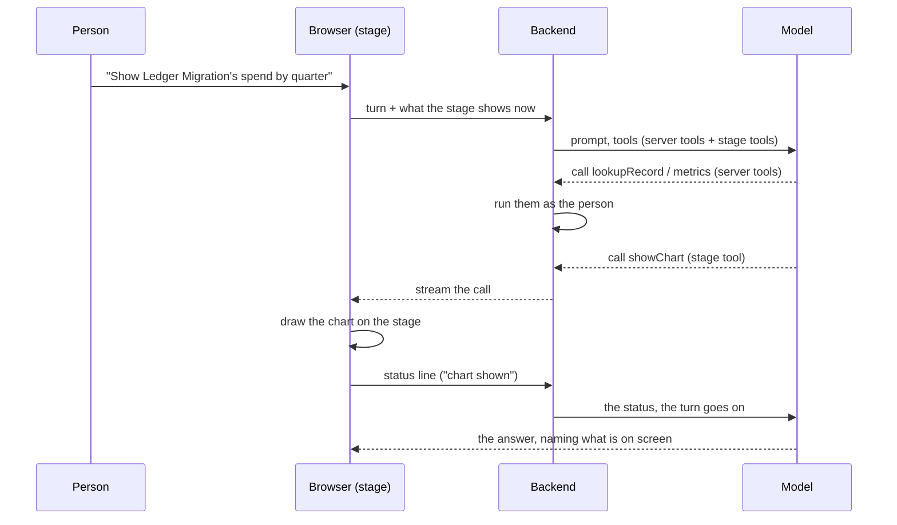
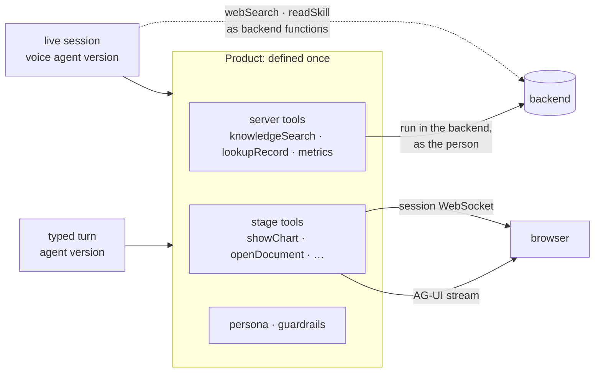
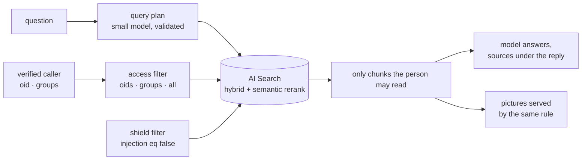
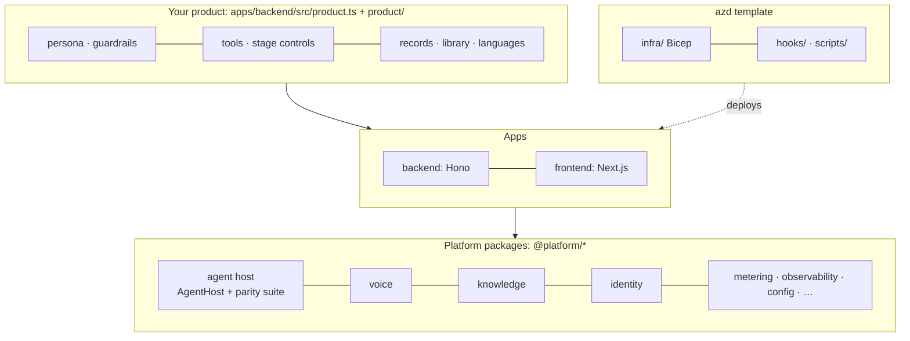

# Patterns

Agent on Azure assembles the parts of a voice-enabled AI application, so your team starts from a working whole. It gives people a conversation they type or speak into, answers from their documents and records, and the **stage**, the visual workspace beside the conversation where those answers are shown. The table below lists each assembled pattern, what you adapt and where the boundary is, and where its code lives. The patterns ship together as one application, not as separately installable modules.

## The assembled patterns

| Pattern | What's assembled | What you adapt, and the boundary | Where it lives |
| --- | --- | --- | --- |
| [Conversation-driven UI](#conversation-driven-ui) | The conversation beside the stage, where the assistant or the person opens documents, pictures, charts and records | Reuse the panels and their presentation. A new kind of view needs frontend and backend code ([a stage tool](extending.md#a-stage-tool)) | [`apps/frontend/src/stage/`](../apps/frontend/src/stage/tools.ts), [`stage-tools.ts`](../apps/backend/src/product/stage-tools.ts) |
| Voice interaction | Live sessions through a Foundry voice agent, relayed by the backend, on a speech-to-speech or cascade engine | Voices, language handling and the engine, through settings, for the next session. No alternative to Voice Live ships, so another voice provider is integration work | [`platform/voice`](../platform/voice/README.md), [`voice-definition.ts`](../platform/agent/src/foundry/voice-definition.ts) |
| Agent orchestration | Foundry Agent Service, reached through the `@azure/ai-projects` and `openai` SDKs behind the `AgentHost` interface: prompt assembly, the tool loop, history and memory | Persona, guardrail wording, tools and skills. Another runtime is a new `AgentHost` that passes the parity suite: a large code change, and live voice binds separately | [`host.ts`](../platform/agent/src/contract/host.ts), [`parity.ts`](../platform/agent/src/contract/parity.ts), [`foundry/`](../platform/agent/src/foundry/host.ts) |
| [One set of tools for voice and text](#one-set-of-tools-for-voice-and-text) | One tool definition that typed turns and live sessions both call, run with the caller's verified identity | Add or replace a tool once, with no business logic per channel. A realtime model's support can differ, so accept both channels | [`product.ts`](../platform/agent/src/contract/product.ts), [`product/tools/`](../apps/backend/src/product/tools/lookup-record.ts) |
| Document retrieval and display | Ingestion, hybrid search with semantic ranking, Prompt Shields screening, the reader and source chips | Content, retrieval settings, and the engine (hybrid or Foundry IQ). Documents enter only through the ingest script ([after the table](#how-documents-enter)). Source chips show provenance, not a check of each claim | [`platform/knowledge`](../platform/knowledge/README.md), [`ingest.sh`](../scripts/ingest.sh) |
| Business-system integration | An example adapter: the records tools read an HTTP API, or the sample records when none is set | Replace the mapping (`mapping.ts`). The target API must accept the backend's identity and caller headers, and page its listings; a listing stops at 500 records and says it is partial ([mapping a real system](worked-example.md#mapping-a-real-system)) | [`product/records/`](../apps/backend/src/product/records/http.ts) |
| Entra ID user identity | Sign-in through Entra (or the demo's name-only sign-in), a required app role in hardened mode, and the verified caller passed to every tool | Configure the customer's tenant, app registration, roles and groups. Sign-in alone does not enforce data permissions | [`auth-providers.ts`](../apps/frontend/src/auth-providers.ts), [`platform/identity`](../platform/identity/README.md) |
| [Permission-aware retrieval](#permission-aware-retrieval) | Readers per document from `access.json`, and a filter from the verified caller on search, document and picture reads | Map readers to the customer's groups and keep the mappings current. Enforcement is on by default for a fresh hardened deployment, and an existing one keeps its stored [access setting](configuration.md#access); in demo mode, turn enforcement on (`access.enforceAccessControl`) before loading restricted documents | [`access.ts`](../platform/knowledge/src/query/access.ts) |
| Service authentication | Managed identities and Entra roles for every Azure service, and a token for the records API | Grant the target's permissions. The receiving API must enforce the user's access itself | [`infra/`](../infra/main.bicep), [`http.ts`](../apps/backend/src/product/records/http.ts) |
| Azure deployment | The azd template in demo and hardened modes, its hooks, and deployment checks | Resources, regions and deployment settings. Customer networking and security approval remain project work | [`infra/`](../infra/main.bicep), [`hooks/`](../hooks/), [`verify-deployment.ts`](../scripts/verify-deployment.ts) |
| [Product separated from platform](#product-separated-from-platform) | Three layers: the product (persona, tools, stage controls, sample data), the platform packages, and the azd template, with dependencies pointing downwards only | Change the product layer and reuse the packages and template as they are; a test holds the boundary | [`product.ts`](../apps/backend/src/product.ts), [`product-boundary.test.ts`](../apps/backend/src/product-boundary.test.ts) |
| Runtime configuration and branding | Validated settings documents in App Configuration, live within about 30 seconds; [`appearance`](configuration.md#appearance) within about a minute (two 30-second caches) | Supported settings, and the palette, type, spacing, corners, name, welcome line and logo. The layout is fixed; a memory-store change needs a restart and a model change a deployment | [`platform/config`](../platform/config/README.md), [`platform/appearance`](../platform/appearance/README.md) |

Four of these are explained in depth below: [conversation-driven UI](#conversation-driven-ui), [one set of tools for voice and text](#one-set-of-tools-for-voice-and-text), [permission-aware retrieval](#permission-aware-retrieval) and [product separated from platform](#product-separated-from-platform). The terms the pages use are defined under [terms](#terms). [What you change, and what it costs](adapting.md#what-you-change-and-what-it-costs) separates settings and data updates from code changes and larger replacements, and the [worked example](worked-example.md) connects another records source while keeping the existing tools and views.

### How documents enter

In this repository, documents enter only through the ingest script ([load a library](documents.md#load-a-library)). Impact AI Admin Center is a separate product that makes ingestion easier ([Admin Center](impact-ai.md#impact-ai-admin-center)).

## Microsoft components

| Component | Role in this implementation | Choice or constraint |
| --- | --- | --- |
| Foundry Agent Service | Agent execution, function tools, agent versions and optional service-managed history and memory | The implemented host; another runtime requires a new host implementation |
| Azure OpenAI | Chat, supporting model calls, embeddings and realtime models | Model deployments are environment/deployment choices, not a general live setting |
| Foundry voice agents / Voice Live | Spoken interaction using the product's tools | Cascade or speech-to-speech, subject to available deployments and supported voices |
| Azure AI Search | Document indexing, hybrid search and semantic ranking | The implemented search service; no supported replacement adapter ships |
| Foundry IQ knowledge base | Alternative retrieval over the same index | Under access enforcement, each call carries the caller's readers clause as a filter |
| Prompt Shields | Screening document passages before retrieval serves them | Filtering reflects screening results, not a guarantee that every attack is detected |
| Microsoft Entra ID | Sign-in, roles, groups and managed-identity service authentication | Document group permissions require the appropriate identity and access configuration |
| Cosmos DB | Accounts, prompt versions and application-owned conversation/memory data | History and memory can use Foundry Agent Service's stores instead ([adapting](adapting.md)) |
| Managed Redis | Shared coordination, allowances and live-session state | Without configured Redis, typed chat works and live voice is unavailable |
| Blob Storage and App Configuration | Documents and runtime settings | Document loads and many settings changes need no application rebuild |
| Container Apps | Application hosting and deployment jobs | Demo and hardened deployment configurations |
| Application Insights / Azure Monitor | Application telemetry and investigation | Configured by the template; [evaluation](evaluation.md) explains optional next steps |
| Front Door / WAF | Edge protection in the hardened configuration | Infrastructure choice; see [deployment](deployment.md) |

## Conversation-driven UI

**The problem.** In a chat-only UI the answer is all text. A chart, a document page or a customer record described in prose is harder to check than one put on screen. And a UI that only the assistant can drive leaves people with no way to get there themselves.

**The pattern.** A **stage** sits beside the conversation. The assistant drives it with *stage tools*: function tools the backend defines, the model calls, and the browser runs. Each one changes what the stage shows and answers with a short status line, so the model knows what the person can now see.

- **By hand.** The library, the records, a document, a record and a record's figures also open by hand: from the top bar's Library and Records, a document card or source chip, a record chip, or a figure chip on a record card. Opening by hand runs the same handler as the tool, so the two routes cannot drift apart.
- **Only from the assistant.** A picture in the media section, a chart of several series, and a searched library or filtered record list. By hand, a picture in the reader opens enlarged.
- **Back to the model.** What is on screen goes to the model on the next turn as a few lines of context, so "show me the second one" works.

**Where it is.**

- **The stage tools** are data, in [`apps/backend/src/product/stage-tools.ts`](../apps/backend/src/product/stage-tools.ts). The backend serves the list to the browser and to the model, on both channels.
- **The handlers** that run them in the browser are in [`apps/frontend/src/stage/tools.ts`](../apps/frontend/src/stage/tools.ts). The state they change is in [`stage.ts`](../apps/frontend/src/stage/stage.ts).
- **Opening by hand:** the top bar's Library and Records go through [`apps/frontend/app/components/stage-controls.tsx`](../apps/frontend/app/components/stage-controls.tsx); the chips on cards go through the workspace's actions ([`apps/frontend/app/(app)/workspace/Workspace.tsx`](../apps/frontend/app/(app)/workspace/Workspace.tsx)). Both call the stage tools' own handlers. The routes behind it are [`record-routes.ts`](../apps/backend/src/product/record-routes.ts) and [`library-routes.ts`](../apps/backend/src/product/library-routes.ts).
- **What the model is told is on screen** comes from [`apps/frontend/src/stage/live-context.ts`](../apps/frontend/src/stage/live-context.ts).
- **The whole typed turn** is in [architecture](architecture.md#a-typed-turn), and adding a control in [extending](extending.md#a-stage-tool).

## One set of tools for voice and text

**The problem.** A voice assistant and a chat assistant built separately end up with two tool sets, two prompts and two permission models, and they drift apart. A tool that looks up a record has to run as the person on both channels, with the same checks.

**The pattern.** Each tool is defined once, in the product. A typed turn runs on the agent's version. A live session runs on a Foundry voice agent's version, and both versions carry the same function tools and are built from the same prompt code. A **server tool** (search, record lookup) runs in the backend in the person's scope, whichever channel called it. A **stage tool** goes to the person's browser: over the AG-UI stream on a typed turn, and over the session's WebSocket on a live one. The voice agent can't hold the service's web search tool next to function tools, so web search reaches voice as one more backend function, and skills reach both channels through one backend function, `readSkill`. The tools and their checks are the same on both channels. What a realtime voice model supports can differ from the typed agent (tools, fillers, voices), as [limitations](limitations.md) records, so acceptance checks both ([voice and text behave the same](acceptance.md#voice-and-text-behave-the-same)). What was said is written into the same conversation, so a typed turn can pick up where the voice left off.

**Where it is.**

- **Defining a tool** uses `productTool` in [`platform/agent/src/contract/product.ts`](../platform/agent/src/contract/product.ts). The sample's tools are in [`apps/backend/src/product/tools/`](../apps/backend/src/product/tools/lookup-record.ts).
- **Who is calling** comes from `currentTurn()` in `@platform/agent`, which gives the verified account, groups and tier, never the tool's input.
- **The voice side** is [`platform/agent/src/foundry/voice-definition.ts`](../platform/agent/src/foundry/voice-definition.ts) (the version) and [`voice-tools.ts`](../platform/agent/src/foundry/voice-tools.ts) (the backend's web search function; the skill reader, both channels', is [`skills/skills.ts`](../platform/agent/src/skills/skills.ts)). The session itself is in [`platform/voice/src/voicelive/exchange.ts`](../platform/voice/src/voicelive/exchange.ts).
- **The full voice flow** is in [architecture](architecture.md#voice), with [tools in a voice session](architecture.md#tools-in-a-voice-session).

## Permission-aware retrieval

**The problem.** If the assistant answers from a shared index, it can quote a document the person may not open. Prompt instructions ("don't reveal HR files") don't enforce anything. The restriction has to live in the query, and in everything that serves what the query found, such as pictures.

**The pattern.** Every document's readers (Entra user and group object ids) are stored on its chunks when the library is loaded. With `enforceAccessControl` enabled, each search carries a filter built from the caller's **verified** identity, read from their account row and never from the request or the model. The filter sits outside the model's query plan, so relaxing the query cannot remove the access restriction. The same access rule applies to document and picture reads. Chunks that Prompt Shields hasn't checked, or has flagged, are not served. An unidentified caller is refused under enforcement. [Adapting](adapting.md#what-you-change-and-what-it-costs) explains the operational choices.

**It is a switch, on by default for a fresh hardened deployment.** The readers are recorded at every load, but the filter is applied only while the `access` document's `enforceAccessControl` is `true`. A new hardened deployment is seeded with it `true` and a demo with `false`; a deployment that already stores the document keeps its value. The sample library opens for anyone who signs in either way, since its `access.json` gives every file to `all`. On a demo, turn it on before you load anything restricted ([documents](documents.md#who-may-read-a-document)); a load that names readers while it is off says so.

**Where it is.**

- **The filter** is `accessFilter` and `servedFilter` in [`platform/knowledge/src/query/access.ts`](../platform/knowledge/src/query/access.ts). The query is in [`retrieve.ts`](../platform/knowledge/src/query/retrieve.ts).
- **The proof** is [`readers.library.test.ts`](../platform/knowledge/src/query/readers.library.test.ts). Two people in different groups each find their own document and never the other's, whether by search, by id or by picture.
- **Who may read what** is set by `access.json` and the two switches, described in [documents](documents.md#who-may-read-a-document). [Security](security.md#who-may-read-a-document) explains why the backend filters itself rather than using Foundry's search tool.

## Product separated from platform

**The problem.** An application that mixes its own assistant into its infrastructure code is hard to adopt. Every customer change touches the hard parts (identity, voice relay, erasure, deployment), and every upgrade becomes a merge.

**The pattern.** There are three layers, and dependencies only point downwards:

- **The product**: the guardrails, tools, stage-tool definitions, languages, sample data and the shipped default persona live in `product.ts` and `product/`. The persona a deployment runs is published data ([changing the persona](operations.md#changing-the-persona)). The backend reads these through the product contract; the frontend also imports the shared locale list. New views also require frontend code.
- **The platform packages** (`@platform/*`): the agent host, voice, retrieval, identity, metering and observability. They know nothing of the product.
- **The azd template**: Bicep, hooks and scripts. It deploys the same way whatever the product is.

The agent service sits behind one interface (`AgentHost`), with a parity suite that any other implementation must pass; replacing the service is still a large code change, and live voice binds separately. Which Azure or Foundry component does a job (memory, history, retrieval engine, voice engine) is chosen when you deploy. Limits and switches are settings documents an operator can change while the service runs.

**Where it is.**

- **The contract a product fills** is `AgentProduct` in [`platform/agent/src/contract/product.ts`](../platform/agent/src/contract/product.ts). The sample fills it in [`apps/backend/src/product.ts`](../apps/backend/src/product.ts).
- **The boundary** is held by a test, [`apps/backend/src/product-boundary.test.ts`](../apps/backend/src/product-boundary.test.ts).
- **Where the agent plugs in** is in [architecture](architecture.md#the-agent-integration-point), and replacing it in [a second agent host](extending.md#a-second-agent-host).
- **Components and settings** are in [choose components at deploy time](deployment.md#choose-components-at-deploy-time) and the [settings documents](configuration.md#settings-documents).
- **The package map** is in [repository](repository.md).

## Terms

- **Stage.** The visual workspace beside the conversation, where the assistant and the person open documents, pictures, charts and records.
- **Stage tool** and **server tool.** A stage tool is a function tool the browser runs to change the stage; a server tool runs in the backend, as the person.
- **Speech-to-speech and cascade.** The two voice engines. Speech-to-speech hands the person's audio to a realtime model that hears it and speaks its answer. The cascade transcribes the audio, answers in text with a chat model, and synthesizes the answer as speech.
- **AG-UI.** The open protocol a typed turn streams over between the backend and the browser ([AG-UI](https://docs.ag-ui.com/)).
- **Capability host.** What Foundry Agent Service runs a project's agents on; the template makes one per account and project, and in hardened mode injects it into the network.
- **Caller assertion.** A short-lived token the frontend signs to tell the backend who is calling, from the verified session; the backend takes who is calling from nothing else ([gates](security.md#gates)).
- **Parity suite.** The tests every agent host must pass, written against the `AgentHost` interface alone ([agent parity](testing.md#layers)).
- **Codex.** OpenAI's coding agent, which the optional Impact SDK setup plugin runs in ([Impact AI Control Plane](impact-ai.md#impact-ai-control-plane)).

For a sense of what an assistant built along these lines can feel like, [Hera Companion](https://hera.esa.int), a project by Terra Mater Studio and the European Space Agency, offers a similar experience: voice, conversation and a visual stage over mission data.
