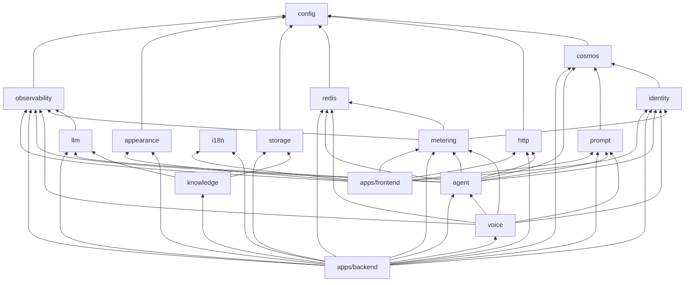

# Repository

This page is the map of the repository for a developer finding their way around: the packages, the two apps, the template, which way dependencies point and the boundaries the build enforces.

Agent on Azure is a Bun workspace: reusable packages under `platform/`, two apps that compose them, and the azd template that deploys the apps.

```
.                         the repository root is the azd template
├── azure.yaml            the two services, the hooks, what azd pipeline config carries
├── infra/                main.bicep (subscription scope), main.parameters.json, modules/, the template's tests
├── hooks/                preprovision, postprovision, postdeploy, predown, and the entra, job and private helpers, each in bash with a PowerShell version; the stand-in az and the runner their tests put both the shell and the PowerShell version through
├── scripts/              ingest (load your documents), smoke (check a deployment), each in bash with a PowerShell version; the test preload and the repository-wide checks
├── docs/                 this documentation and the tests that keep it true
├── .github/              the workflows (CI, the audit, the site, and the Development and Production releases), dependabot.yml, CODEOWNERS, the issue forms and the pull request template
├── releases/             production.json, the version Production runs, once a pull request to production pins one
├── .devcontainer/        Ubuntu with az, azd, Docker and the pinned Bun
├── .githooks/            pre-commit: Biome over the staged files; an install points core.hooksPath here
├── .fallowrc.jsonc       dead code, duplication and import cycles
├── .bun-version          the one Bun version: CI, the images and the dev container
├── CLAUDE.md             the rules a coding agent follows here
├── apps/
│   ├── backend/          the agent's server (Bun + Hono); the product lives in src/product.ts and src/product/
│   └── frontend/         the web app (Next.js)
└── platform/             the packages, published inside the workspace as @platform/*
```

## The packages

Each has a README with its contract, its settings and how it is tested.

| Package | Responsibility |
| --- | --- |
| [`config`](../platform/config/README.md) | Typed environment reads, App Configuration, the cached settings document that falls back to its default on failure, the deployment guard. |
| [`test-support`](../platform/test-support/README.md) | Test-scoped environment variables, a stand-in that hands the real export back. Tests only. |
| [`cosmos`](../platform/cosmos/README.md) | One Cosmos DB database, keyless: the container surface every store is written against, the containers each package declares, the start's check, and an in-memory stand-in held to the emulator. |
| [`http`](../platform/http/README.md) | Keep-alive for streams through a proxy, the `edge` body limit, bounded body reads. |
| [`redis`](../platform/redis/README.md) | One Redis connection, never required: deadlines, key scheme, a cache shared across replicas, claims and locks. |
| [`observability`](../platform/observability/README.md) | OpenTelemetry for Bun and Next, the scrub every span passes, the `problem` and `llm_usage` lines. |
| [`i18n`](../platform/i18n/README.md) | The locale registry and the one resolution order for a request. |
| [`identity`](../platform/identity/README.md) | Sign-in rules, app roles and groups, the account that is one person, signed service-to-service assertions. |
| [`storage`](../platform/storage/README.md) | Keyless Blob Storage: the library container's blobs listed with their metadata, read, written and deleted. |
| [`appearance`](../platform/appearance/README.md) | The [`appearance`](configuration.md#appearance) document: palette, type, spacing, corners, the assistant's name and welcome line, and the logo per deployment, held to WCAG AA, and the style sheet it injects. |
| [`metering`](../platform/metering/README.md) | The `limits` document, credit buckets, per-account allowances, the record of live-voice seconds used. |
| [`prompt`](../platform/prompt/README.md) | The three-part system prompt, tunable guardrails, the persona's versions. |
| [`llm`](../platform/llm/README.md) | Azure OpenAI model adapters on the managed identity, with concurrency caps, retries and usage lines. |
| [`knowledge`](../platform/knowledge/README.md) | Retrieval over one AI Search index that Azure's indexer fills: the index and the pipeline's definitions, a library described in blob metadata, the Prompt Shields scan, the planned hybrid query, document access. |
| [`voice`](../platform/voice/README.md) | Live voice with a Foundry voice agent: the protocol client, and the relay that holds both sockets of a session — the browser's and the voice agent's — on the replica the browser reached, metered. |
| [`agent`](../platform/agent/README.md) | The `AgentHost` interface and its implementation on Foundry Agent Service: agent versions, the tool loop, the memory store or the deployment's own by one setting, skills, web search, thread ownership, idempotent turns, erasure. |

The apps: [`apps/backend`](../apps/backend/README.md) and [`apps/frontend`](../apps/frontend/README.md).

## Dependency direction

Packages depend downwards only; nothing in `platform/` imports an app.



The arrows are the dependencies each `package.json` declares, every one of them, so an arrow another already implies is drawn all the same. `i18n` and `test-support` depend on nothing, and every other package depends on `config`, which the diagram leaves out. A package's `./testing` entry is for tests only. One edge is not a package's: the frontend reads the product's locale list from the backend's source (`apps/backend/src/product/locales.ts`), so the two apps cannot disagree on the languages ([extending](extending.md)). Nothing but review holds the downward direction; the build refuses only a cycle.

## Boundaries the build enforces

| Check | What it refuses | Where |
| --- | --- | --- |
| fallow | An export, file or dependency nothing uses; a copy-pasted block (50 tokens, 5 lines); an import cycle | `.fallowrc.jsonc`, the CI `quality` job |
| Environment parity | A variable an app's source reads that its `.env.example` and the template do not set; a variable named for a secret that is not a Key Vault reference | `infra/app-env.test.ts` |
| Documentation drift | A parameter, variable or settings field missing from [configuration](configuration.md) or documented there and gone from the code, a default that is a literal and differs, or a broken relative link in these pages, the root's Markdown files or a README | `docs/configuration.test.ts`, `docs/links.test.ts` |
| Catalog parity | A key one language's message catalog has and another lacks; an error code with no sentence | `apps/frontend/catalogue-parity.test.ts` |
| AI disclosure | A disclosure string with no surface that renders it | `apps/frontend/ai-disclosure.test.ts` |
| Model retirement | A pinned model version not in the register, or within 30 days of retirement without an acknowledged plan | `infra/model-deprecations.test.ts` |
| Pipeline parity | A value the template reads that no pipeline run would carry | `pipeline.test.ts` |
| Dependency pins | `latest`, `next` or a wildcard as a version, in a dependency, an override, a resolution or an `npm:` alias | `scripts/dependency-pins.test.ts` |
| Template prose | A calendar date that is not a version, or a pointer into an engineering record, in the documentation, any Markdown file at the root or in a code tree, a code comment or a test name, the git hooks and the root's own code included | `scripts/template-prose.test.ts` |
| Mermaid diagrams | A diagram in any Markdown page that Mermaid cannot parse, which GitHub would draw as an error | `scripts/mermaid.test.ts` |

## Where to add things

| You want to… | Put it in | See |
| --- | --- | --- |
| Change what the assistant is called, its persona, guardrail wording, tools or languages | `apps/backend/src/product.ts`, `apps/backend/src/product/`; the displayed name, welcome line, logo and colors are also the [`appearance`](configuration.md#appearance) settings document | [extending](extending.md) |
| Add a server-side tool | `apps/backend/src/product/tools/` | [extending](extending.md#a-server-side-tool) |
| Add a control the assistant drives on screen | `apps/backend/src/product/stage-tools.ts` and `apps/frontend/src/stage/` | [extending](extending.md#a-stage-tool) |
| Add a tunable | A field in the owning package's settings default | [extending](extending.md#a-settings-field) |
| Add a resource or a role assignment | `infra/main.bicep` and a module under `infra/modules/` | [architecture](architecture.md#identities-and-roles) |
| Add an environment variable | The app's `.env.example`, the template's env list, [configuration](configuration.md#environment-variables) | the parity and drift tests fail until all three agree |
| Add something only the product needs | The app, never `platform/` | — |
| Add something every product would need | The owning `platform/` package, named for the agent, the person or the product, never for Agent on Azure | — |
