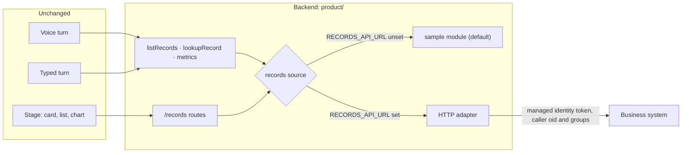

# Worked example

This page guides a team through the change it usually makes first: having the assistant answer from the customer's own system (a CRM, an asset register, a directory).

Agent on Azure already contains an HTTP records adapter, tested on every build. To point it at your system:

1. Meet the [contract the adapter expects](#the-contract-the-adapter-expects), often with a small API in front of the system.
2. Write the [mapping](#the-mapping-to-replace) from the system's record to the app's.
3. [Run it locally](#run-it-locally) against the stand-in, then against your system.
4. [Point a deployment at your system](#point-a-deployment-at-your-system) and run the [checks before going live](#verification).

The system then decides what each person may see, and the records the assistant looks up, lists and charts come from it instead of the sample data.

## What changes and what does not

The record tools (`listRecords`, `lookupRecord`, `metrics`) and the routes the [stage](patterns.md#terms) reads directly ask a **records source**. Two sources answer the same questions: the sample data, the default, and the business system when `RECORDS_API_URL` names one.



The model never decides who is asking. A tool takes the caller from the turn it runs in (`currentTurn()`, which the backend's sign-in check fills from the account's row). A route takes it from the account the backend checked, including its standing (whether the account may use the service). The adapter sends that person's object id and groups in two headers, `X-Caller-Oid` and `X-Caller-Groups`. It makes the call with the backend's own managed identity token, so the system trusts those headers from that identity only. The system answers only what that person may see, and answers a record they may not see as it answers one that does not exist. A card leaves off a link to a record its reader may not open, so it does not reveal that the record exists.

**Your system enforces each person's access itself.** The backend calls with its own identity, not the person's, so the receiving API must authenticate the backend and enforce each person's access from the two headers itself. Pointing the adapter at Microsoft Graph or a CRM's own API does not give you that: those check the caller's token, which here is the backend's. Put a small API of your own in front of such a system, or extend the adapter to call it on the person's behalf.

Every question has a five-second deadline, and it covers the whole question: minting the token, every request (all the pages of a listing) and reading every body. A slow system or token provider, a system that is down, and a system that answers something other than records all give a `RecordsUnavailable`. A tool returns that as a value (`unavailable` and a reason the model says plainly), so the turn goes on. A route answers it with a 503 the interface already has a sentence for.

## The files

| File | What it does | Kind |
| --- | --- | --- |
| [`product/records/contract.ts`](../apps/backend/src/product/records/contract.ts) | The source's interface, the caller it is asked as, and the one failure. | Code |
| [`product/records/http.ts`](../apps/backend/src/product/records/http.ts) | The adapter. It makes the calls, follows a listing's pages up to its bound, and bounds each question with one deadline. | Code |
| [`product/records/mapping.ts`](../apps/backend/src/product/records/mapping.ts) | The mapping from the system's record to the app's, validated with Zod. The default reads the stand-in's format (`type`, `key`, `title`, `attributes`, `related`, `quarterly`). | Code, replaced per system |
| [`product/records/project-mapping.ts`](../apps/backend/src/product/records/project-mapping.ts) | A worked mapping for a project API shaped unlike the app ([below](#mapping-a-real-system)). | Code (example) |
| [`product/records/source.ts`](../apps/backend/src/product/records/source.ts) | The choice between the sample data and the system, the turn's caller, and the card with links filtered. | Code |
| [`product/records/standin.ts`](../apps/backend/src/product/records/standin.ts) | A stand-in for the system, in the sample's format or as the project API, for the tests and for running locally with no system. | Code (test support) |
| `product/tools/list-records.ts`, `lookup-record.ts`, `metrics.ts` | Ask the source, as the turn's caller; answer `unavailable` when the system cannot answer, and `truncated` when a listing is partial. | Code |
| [`product/record-routes.ts`](../apps/backend/src/product/record-routes.ts) | Asks the source as the account the backend checked; 503 when it cannot answer. | Code |
| `product/sample/records.ts` | The sample records, their kinds and measures. The card itself is built by the source (`recordCard`), which needs the caller. | Code |
| `apps/backend/.env.example`, `infra/main.parameters.json`, `infra/main.bicep`, `infra/modules/backend.bicep`, [configuration](configuration.md#the-records-system) | Carry `RECORDS_API_URL` and `RECORDS_API_SCOPE`, deploy-time azd variables, empty by default. | Configuration |

All of it is in the backend's `product/` folder, the part of Agent on Azure a team replaces ([extending](extending.md#make-it-yours)). To point a deployment at a system, see [below](#point-a-deployment-at-your-system). Record kinds other than people, projects, customers and assets, or figures kept over other quarters, also change the kinds and measures in `product/sample/records.ts`, which the stage's controls describe to the model. A measure is named on the card and its chart by its key in the frontend's catalogs (`record.measureNames` in `apps/frontend/messages/`); one they do not name reads as its key in words, `billableHours` as "billable hours". A quarter the system keeps no figure for is missing, not zero: it is `null` in the series the model reads and a gap in the chart's line. For a measure that adds up, a year missing a quarter has no total.

## What stayed reusable

None of these changes when you connect a system, and none of them knows which source answers:

- **The stage**, in the frontend: the record card, the records list, the chart and their controls (`showRecord`, `showRecords`, `showChart`), the Records mark on the bar, and a card's chips for its figures.
- **Voice**: a live session calls the same three tools in the person's scope, so speaking to the system works as typing does.
- **The agent host** (`@platform/agent`): admission, the turn's scope and caller, tool validation, and the Foundry Agent Service client.
- **The checks in front of every route**: sign-in, the [caller assertion](patterns.md#terms), account standing, allowances and the guard that shuts an account being erased.
- **The model's instructions**: the tools' descriptions name the `unavailable` case. The channel instructions (the per-channel instructions in `apps/backend/src/product/surface.ts`, written for typed turns and spoken for voice; see [architecture](architecture.md#a-typed-turn)) and the persona stay as they are.

## Mapping a real system

The adapter keeps one contract with the system and hands every record it receives to one mapping function. Connecting your own system means meeting the contract, often with a small API in front of it, and writing the mapping.

### The contract the adapter expects

Two requests under `RECORDS_API_URL`, each with the backend's token (when `RECORDS_API_SCOPE` is set) and the caller's `X-Caller-Oid` and `X-Caller-Groups`:

| Request | Answer |
| --- | --- |
| `GET /records/{kind}/{id}` | One record, or a 404 when there is none or the caller may not see it. |
| `GET /records?kind=&q=&limit=50&cursor=` | One page: `{ "items": [ … ], "next": "…" }`. `kind` and `q` are present only when the question names them. |

Search is the system's own. The adapter passes the model's query through as `q` unchanged and filters nothing itself, so what `q` matches decides which questions a listing can narrow. Match it, case-insensitively, against the record's identifier, its name and the values a person asks by: a status by its code and its words, and a date by its ISO prefix (`2027-01` for the first month of 2027). The project stand-in does this. A question the query cannot narrow is still answered from the listing's lines, at the cost of a longer listing.

The adapter asks for pages of 50 (`PAGE_SIZE`) and sends a page's `next` back as `cursor` until a page has no `next`. The cursor is opaque to the adapter: an offset, a token or a continuation key all work. A system that does not page answers one page with no `next`, and that page is the whole listing.

A listing stops at 500 records or 20 pages (`LIST_MAX` and `PAGES_MAX` in `http.ts`). Five hundred one-line summaries are about as much as one tool answer and one list on the stage are useful with. When the system holds more, the listing is cut there and marked `truncated`. The model then says the list is partial and asks for a narrower question. The system still decides what the caller may see on every page: the adapter never filters by access itself.

### The mapping to replace

[`mapping.ts`](../apps/backend/src/product/records/mapping.ts) defines a mapping as two things: a Zod schema for one record as the system answers it, and `toRecord`, which turns that record into the app's (`SampleRecord`: kind, id, name, labeled fields, links and quarterly figures). The record's optional `summaryFields` names, by label, the fields its line in a listing carries; without it the line carries the first two. The model answers "which…" questions from those lines, so name the fields people filter by, and keep the line short: up to 500 of them go into one answer. The adapter uses `recordMapping`. Point it at your own mapping and leave `http.ts` as it is. A record that fails the schema makes the whole answer unavailable, so the assistant never shows half a record.

### A worked mapping: a project API

[`project-mapping.ts`](../apps/backend/src/product/records/project-mapping.ts) maps a project API whose records look nothing like the app's:

```json
{
  "project_number": "P-0001",
  "customer_name": "Acme",
  "budget_minor": 12500000,
  "currency": "USD",
  "delivery_date": null,
  "status": "on_hold",
  "reader_groups": ["delivery"]
}
```

It becomes the project record `P-0001 (Acme)`, with four fields:

| Field | Value | Rule |
| --- | --- | --- |
| Customer | Acme | Renamed. A missing customer reads "Not provided". |
| Budget | USD 125,000.00 | Minor units divided by the currency's own exponent: cents for USD and EUR, none for JPY (`JPY 15,000,000`). A missing budget reads "Not provided", never a zero. |
| Delivery date | Not provided | An ISO date (`2027-03-15`) reads as US English writes it, with the month in words. A day the month does not have is refused. |
| Status | On hold | Each status code in words; a code added later reads as itself in words. |

A project's line in a listing carries its status, delivery date and budget (`PROJECT_SUMMARY_FIELDS`), not the customer its name already holds, so "Which projects deliver in Q1 2027?" is answered from one listing: about 150 characters a project, 30 KB for 200. `reader_groups` is the system's to enforce, so the mapping does not read it. The API keeps no quarterly figures, so its projects have none, and their cards offer no chart. A system that does keep figures maps them to `figures`, with `null` where a quarter is missing.

### Run it locally

With the backend run as [development](development.md#run-it-with-no-azure-at-all) describes, start the stand-in and point the backend at it:

```sh
# terminal 0: the stand-in system on :4400
bun apps/backend/src/product/records/standin.ts 4400

# terminal 1: the backend, reading it
RECORDS_API_URL=http://localhost:4400 REDIS_URL=redis://127.0.0.1:6379 PORT=4199 bun apps/backend/src/testing/dev-fake.ts
```

The stand-in listens on 127.0.0.1; give it a host as its third argument (`standin.ts 4400 sample 0.0.0.0`) to reach it from another container.

The stand-in shows customers only to someone in the group `records-customers`. A local sign-in has no groups, so the Records mark lists people, projects and assets, and a project's card leaves off its customer. The stand-in trusts the caller headers from anyone. A real system trusts them only from the backend's identity.

To try the project API instead, start the stand-in with `projects` as its second argument (`standin.ts 4400 projects`) and set `recordMapping` in `mapping.ts` to `projectMapping`. It serves 200 projects everybody may see, in pages of 50, and `P-9001`, which only the group `records-executives` may see. The Records mark then lists the 200 projects, read in four pages, and a project's card shows its budget, delivery date and status as the mapping writes them.

### Point a deployment at your system

Set `recordMapping` in `mapping.ts` to your system's mapping and deploy the backend with it, which still reads the sample records. Then set the two azd variables, which the provision gives the backend's container. In that order, the backend never reads the system through the default mapping:

```sh
azd deploy backend
azd env set RECORDS_API_URL https://records.example.com
azd env set RECORDS_API_SCOPE api://<the system's app id>/.default
azd provision
```

The backend's managed identity requests the token itself and needs no role on this side. The system's app registration must accept it: an app role on the registration, assigned to the identity `AZURE_CLIENT_ID` names. A system on the internet is reached in both modes; one on a private network, only with private networking and a route from the virtual network ([configuration](configuration.md#the-records-system)). A pipeline carries the two values once `azd pipeline config` has been run again ([CI/CD](deployment.md#cicd)).

## Verification

**Automated, against the stand-in** ([`records.test.ts`](../apps/backend/src/product/records/records.test.ts) for the sample's format, [`projects.test.ts`](../apps/backend/src/product/records/projects.test.ts) for the project API, both run by `bun test` on every build):

| Scenario | Checked by |
| --- | --- |
| The system's format maps to the sample data's, record for record | the record the adapter finds equals the sample data's |
| Only what the caller may see; a hidden record answers as a missing one; nobody verified sees what everybody may | listing and finding customers as a member and a non-member of the group, and as nobody |
| A card leaves off links the reader may not open | the project's card as each caller |
| The caller comes from the turn, never from the model's input | the tool run in a turn scope, and the headers the stand-in received |
| A slow, failing or garbled system is a reason, not a failed turn | a deadline passed, a 500, a body that is not a listing, an address nothing answers |
| A token goes with every call when a scope is set | the `Authorization` header the system received |
| The stage's routes answer as the account the backend checked, and 503 when the system is down | the backend's app, called with a real caller assertion |
| The project API's mapping: renamed fields, amounts in minor units, dates, statuses, and a missing value as "Not provided" | the mapping's output for whole records and for each rule, and the records it refuses |
| A listing follows every page, in order, as the same caller | 200 projects read in four pages, with the cursors the stand-in received |
| A listing past the bound stops and says it is partial; a system that never stops paging still stops | 520 projects listed as 500 and `truncated`; a system answering empty pages with a `next` |
| A system that does not page is read as one page | a single answer of 80 records, and one of 600 cut at the bound |
| One deadline covers every page, and one token is minted per question | four pages that each fit the deadline and together do not; the `Authorization` header on each page |
| The restricted project is invisible outside its reader group | finding and listing `P-9001` as a non-member, as nobody and as a member |

The sample data's tool suites (`sample-tools.test.ts`, `app.test.ts`) run against the same tools, and `src/product-boundary.test.ts` holds that nothing outside `product/` names the product.

**Before going live, check on your deployment**, pointed at a real system ([deployment checker](deployment.md#deployment-checker)):

- the managed identity's token is accepted by the system;
- a typed turn and a live voice session both answer about a record, and put its card and a chart on the stage;
- a person outside the system's group is not shown a restricted record by either channel;
- a question that matches more records than the bound gets a partial list the assistant says is partial;
- a system taken offline gives a spoken and a written "cannot read the records right now", not a failed turn.
